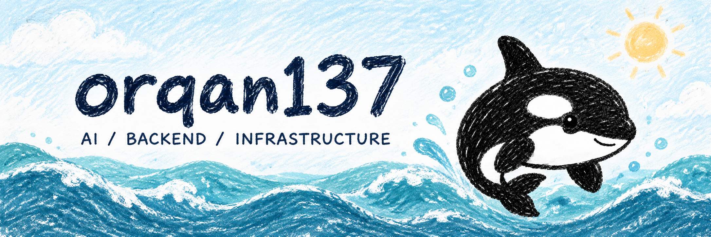

<strong>임&#8288;성&#8288;혁 / AI / Backend / Infrastructure</strong>

AI 서&#8288;비&#8288;스&#8288;를 개&#8288;발&#8288;하&#8288;고, 서&#8288;비&#8288;스 운&#8288;영&#8288;에 필&#8288;요&#8288;한 인&#8288;프&#8288;라&#8288;를 구&#8288;축&#8288;합&#8288;니&#8288;다.

  
  

<strong>목&#8288;차</strong> 
<a href="#experience">01. Experience</a> /
<a href="#tech-stack">02. Tech Stack</a> /
<a href="#projects">03. Projects</a> /
<a href="#activity">04. Activity</a> /
<a href="#community">05. Community</a> /
<a href="#awards">06. Awards</a>

## 🪸 01. Experience

<table>
<tr><td>

<h3>한&#8288;국&#8288;식&#8288;품&#8288;연&#8288;구&#8288;원</h3>

<strong>소&#8288;속 / 직&#8288;위</strong> AI&#8288;정&#8288;보&#8288;실 / 학&#8288;생&#8288;연&#8288;구&#8288;원

<strong>재&#8288;직&nbsp;기&#8288;간</strong> 2025.09–현&#8288;재

<strong>AI 서&#8288;비&#8288;스&#8288;와 백&#8288;엔&#8288;드 개&#8288;발, 온&#8288;프&#8288;레&#8288;미&#8288;스 인&#8288;프&#8288;라 구&#8288;축 및&nbsp;운&#8288;영</strong>

자&#8288;료 반&#8288;출 제&#8288;약&#8288;에 맞&#8288;춰 로&#8288;컬 LLM 기&#8288;반 AI 서&#8288;버&#8288;를 설&#8288;계&#8288;하&#8288;고 데&#8288;이&#8288;터&#8288;플&#8288;랫&#8288;폼&#8288;에 연&#8288;결&#8288;했&#8288;습&#8288;니&#8288;다. 연&#8288;구&#8288;자&#8288;용 Agent 플&#8288;랫&#8288;폼&#8288;과 Kubernetes 전&#8288;환&#8288;을 직&#8288;접 제&#8288;안&#8288;해 개&#8288;발&#8288;과 구&#8288;축&#8288;을 맡&#8288;았&#8288;습&#8288;니&#8288;다. 서&#8288;비&#8288;스&#8288;의 응&#8288;답 지&#8288;연&#8288;을 개&#8288;선&#8288;하&#8288;고 웹 자&#8288;동 배&#8288;포 및 공&#8288;유 서&#8288;비&#8288;스&#8288;도 직&#8288;접 개&#8288;발&#8288;했&#8288;습&#8288;니&#8288;다.

<a href="#work-projects">업&#8288;무 프&#8288;로&#8288;젝&#8288;트 보&#8288;기 ↓</a> / <a href="https://data.kfri.re.kr/">데&#8288;이&#8288;터&#8288;플&#8288;랫&#8288;폼 ↗</a>

<h4>주&#8288;요&nbsp;결&#8288;과</h4>
<ul><li><strong>RAG 문&#8288;서 처&#8288;리 10&#8288;분 → 평&#8288;균 3&#8288;분&nbsp;이&#8288;하</strong></li><li><strong>Agent 요&#8288;청 준&#8288;비 4.2&#8288;초 → 0.14&#8288;초</strong></li><li><strong>운&#8288;송&#8288;장 매&#8288;칭 화&#8288;면 초&#8288;기 표&#8288;시 32.176&#8288;초 → 1.862&#8288;초</strong></li></ul>
</td></tr>
</table>

<a href="#contents">전&#8288;체 목&#8288;차 ↑</a>

## 🫧 02. Tech Stack

<table>
<tr><td><strong>Languages</strong></td><td>    </td></tr>
<tr><td><strong>Backend</strong></td><td>      </td></tr>
<tr><td><strong>Web &amp; Mobile</strong></td><td>    </td></tr>
<tr><td><strong>Data &amp; Search</strong></td><td>    </td></tr>
<tr><td><strong>AI &amp; LLM</strong></td><td>      </td></tr>
<tr><td><strong>Infrastructure</strong></td><td>       </td></tr>
<tr><td><strong>CI/CD &amp; Monitoring</strong></td><td>    </td></tr>
</table>

<a href="#contents">전&#8288;체 목&#8288;차 ↑</a>

## 🐚 03. Projects

<strong>프&#8288;로&#8288;젝&#8288;트&nbsp;분&#8288;류</strong> 
<a href="#work-projects">3.1 Work Projects</a> 
<a href="#apps-projects">3.2 Apps</a> 
<a href="#ai-challenges">3.3 AI Challenges</a> 
<a href="#school-projects">3.4 Campus Projects / 교&#8288;내 프&#8288;로&#8288;젝&#8288;트</a>

### 3.1 Work Projects

<a href="#project-01">01. 연&#8288;구&#8288;데&#8288;이&#8288;터&#8288;플&#8288;랫&#8288;폼</a> 
<a href="#project-02">02. 연&#8288;구&#8288;자&#8288;용 AI Agent 플&#8288;랫&#8288;폼</a> 
<a href="#project-03">03. 주&#8288;문&#8288;배&#8288;송 관&#8288;리 서&#8288;비&#8288;스</a> 
<a href="#project-04">04. Kubernetes 클&#8288;러&#8288;스&#8288;터 구&#8288;축 및 서&#8288;비&#8288;스 이&#8288;관</a> 
<a href="#project-05">05. Ceph 분&#8288;산 스&#8288;토&#8288;리&#8288;지 구&#8288;축 및 데&#8288;이&#8288;터 이&#8288;관</a> 
<a href="#project-06">06. vLLM 기&#8288;반 LLM 추&#8288;론 서&#8288;비&#8288;스</a>

<table align="left" width="400">
<tr><td width="400" valign="top">

<a href="https://data.kfri.re.kr/">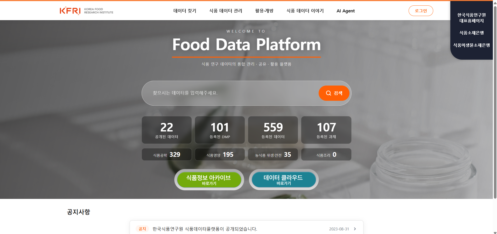</a>
<h3>01. 식&#8288;품&#8288;데&#8288;이&#8288;터&#8288;플&#8288;랫&#8288;폼</h3>

<strong>수&#8288;행&nbsp;경&#8288;력</strong> 2025.09 -&nbsp;현&#8288;재

연&#8288;구&#8288;자&#8288;의 자&#8288;료 검&#8288;색&#8288;과 데&#8288;이&#8288;터&#8288;관&#8288;리&#8288;계&#8288;획 초&#8288;안 작&#8288;성&#8288;을 돕&#8288;는 AI 서&#8288;버&#8288;를 직&#8288;접 설&#8288;계&#8288;하&#8288;고 기&#8288;존 데&#8288;이&#8288;터&#8288;플&#8288;랫&#8288;폼&#8288;에 연&#8288;결&#8288;했&#8288;습&#8288;니&#8288;다. 자&#8288;료 반&#8288;출 제&#8288;약&#8288;에 맞&#8288;춰 원&#8288;내 로&#8288;컬 LLM&#8288;을 선&#8288;택&#8288;했&#8288;으&#8288;며 FastAPI&#8288;와 LlamaIndex&#8288;로 검&#8288;색&#8288;과 초&#8288;안 생&#8288;성 기&#8288;능&#8288;을 구&#8288;현&#8288;했&#8288;습&#8288;니&#8288;다.

<h4>주&#8288;요&nbsp;결&#8288;과</h4>
<ul><li><strong>작&#8288;성 화&#8288;면&#8288;과 AI 진&#8288;행 상&#8288;태&nbsp;개&#8288;선</strong> 반&#8288;복 스&#8288;크&#8288;롤&#8288;이 필&#8288;요&#8288;했&#8288;던 작&#8288;성 화&#8288;면&#8288;을 탭 구&#8288;조&#8288;로 바&#8288;꾸&#8288;고 서&#8288;비&#8288;스 API&#8288;를 개&#8288;발&#8288;했&#8288;습&#8288;니&#8288;다. 검&#8288;색&#8288;과 도&#8288;구 호&#8288;출 상&#8288;태&#8288;는 SSE&#8288;로 전&#8288;달&#8288;하&#8288;고 연&#8288;결 종&#8288;료&#8288;와 API 예&#8288;외&#8288;를 처&#8288;리&#8288;했&#8288;습&#8288;니&#8288;다.</li><li><strong>RAG 문&#8288;서 처&#8288;리 10&#8288;분 → 평&#8288;균 3&#8288;분&nbsp;이&#8288;하</strong> 반&#8288;복 LLM 호&#8288;출&#8288;을 줄&#8288;여 RAG 문&#8288;서 처&#8288;리 시&#8288;간&#8288;을 10&#8288;분&#8288;에&#8288;서 평&#8288;균 3&#8288;분 이&#8288;하&#8288;로 단&#8288;축&#8288;하&#8288;고 품&#8288;질&nbsp;유&#8288;지</li></ul>

<strong>사&#8288;용&nbsp;기&#8288;술</strong>     

<a href="https://data.kfri.re.kr/">공&#8288;개 웹&#8288;사&#8288;이&#8288;트 ↗</a> 업&#8288;무 프&#8288;로&#8288;젝&#8288;트 / 코&#8288;드&nbsp;비&#8288;공&#8288;개

</td></tr>
</table>

<table align="left" width="400">
<tr><td width="400" valign="top">

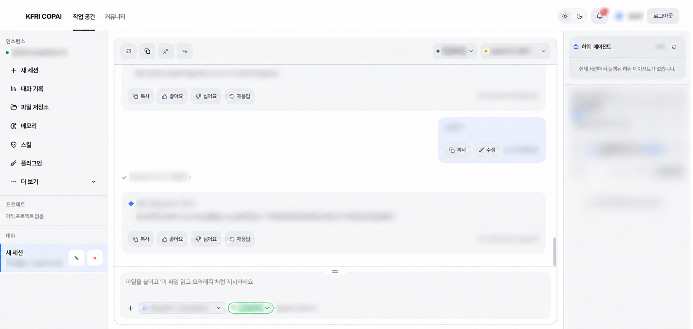
<h3>02. COPAI / 연&#8288;구&#8288;자&#8288;용 Agent&nbsp;플&#8288;랫&#8288;폼</h3>

<strong>수&#8288;행&nbsp;경&#8288;력</strong> 2025.09 -&nbsp;현&#8288;재

기&#8288;밀&#8288;자&#8288;료&#8288;를 내&#8288;부&#8288;에&#8288;서 처&#8288;리&#8288;하&#8288;고 검&#8288;증&#8288;된 AI 활&#8288;용&#8288;법&#8288;과 도&#8288;구&#8288;를 함&#8288;께 쓸 수 있&#8288;도&#8288;록 연&#8288;구&#8288;자&#8288;용 Agent 플&#8288;랫&#8288;폼&#8288;을 제&#8288;안&#8288;하&#8288;고 직&#8288;접 설&#8288;계&#8288;했&#8288;습&#8288;니&#8288;다. 개&#8288;인&#8288;별 VM 제&#8288;공&#8288;만&#8288;으&#8288;로&#8288;는 활&#8288;용&#8288;법&#8288;이 흩&#8288;어&#8288;진&#8288;다&#8288;고 판&#8288;단&#8288;해 개&#8288;인 실&#8288;행&#8288;환&#8288;경&#8288;과 공&#8288;유 자&#8288;산&#8288;을 함&#8288;께 관&#8288;리&#8288;하&#8288;도&#8288;록 구&#8288;성&#8288;했&#8288;습&#8288;니&#8288;다.

플&#8288;랫&#8288;폼&#8288;과 Agent 사&#8288;이&#8288;에 요&#8288;청 전&#8288;달&#8288;과 통&#8288;제&#8288;를 맡&#8288;는 중&#8288;간 제&#8288;어 계&#8288;층&#8288;을 두&#8288;어 Agent&#8288;를 교&#8288;체&#8288;할 수 있&#8288;도&#8288;록 설&#8288;계&#8288;했&#8288;습&#8288;니&#8288;다. Agent&#8288;로 만&#8288;든 웹&#8288;서&#8288;비&#8288;스&#8288;를 배&#8288;포&#8288;하&#8288;고 공&#8288;유&#8288;하&#8288;는 Vibe 서&#8288;비&#8288;스&#8288;도 직&#8288;접 개&#8288;발&#8288;했&#8288;습&#8288;니&#8288;다.

<h4>주&#8288;요&nbsp;결&#8288;과</h4>
<ul><li><strong>요&#8288;청 준&#8288;비 시&#8288;간 4.2&#8288;초 → 0.14&#8288;초</strong> 
채&#8288;팅 준&#8288;비&#8288;와 주&#8288;기&#8288;적 감&#8288;시&#8288;마&#8288;다 작&#8288;업&#8288;공&#8288;간 전&#8288;체&#8288;에 du&#8288;가 중&#8288;복 실&#8288;행&#8288;되&#8288;는 I/O 병&#8288;목&#8288;을 확&#8288;인. 개&#8288;인 Gateway&#8288;의 공&#8288;유 provider&#8288;인 FilesService&#8288;에 진&#8288;행 중&#8288;인 스&#8288;캔 Promise&#8288;와 검&#8288;사 결&#8288;과&#8288;를 보&#8288;관&#8288;해 여&#8288;러 요&#8288;청&#8288;이 같&#8288;은 스&#8288;캔 작&#8288;업&#8288;과 결&#8288;과&#8288;를 공&#8288;유&#8288;하&#8288;도&#8288;록&nbsp;구&#8288;현

용&#8288;량 검&#8288;사 시 일&#8288;반 메&#8288;시&#8288;지&#8288;는 미&#8288;리 정&#8288;확&#8288;히 측&#8288;정&#8288;한 작&#8288;업&#8288;공&#8288;간 사&#8288;용&#8288;량&#8288;을 재&#8288;사&#8288;용&#8288;하&#8288;고 파&#8288;일 쓰&#8288;기 요&#8288;청&#8288;은 실&#8288;시&#8288;간&#8288;으&#8288;로 사&#8288;용&#8288;량&#8288;을 다&#8288;시 검&#8288;사&#8288;하&#8288;도&#8288;록 변&#8288;경. 모&#8288;든 요&#8288;청&#8288;의 권&#8288;한 확&#8288;인&#8288;은 그&#8288;대&#8288;로&nbsp;유&#8288;지

특&#8288;정 인&#8288;스&#8288;턴&#8288;스&#8288;의 동&#8288;일 환&#8288;경&#8288;에&#8288;서 요&#8288;청 접&#8288;수&#8288;부&#8288;터 정&#8288;보 준&#8288;비&#8288;까&#8288;지 걸&#8288;리&#8288;는 시&#8288;간&#8288;을 4.2&#8288;초&#8288;에&#8288;서 0.14&#8288;초&#8288;로&nbsp;단&#8288;축
</li><li><strong>재&#8288;연&#8288;결 시 중&#8288;복 실&#8288;행 요&#8288;청&nbsp;방&#8288;지</strong> 연&#8288;결&#8288;이 끊&#8288;겼&#8288;을 때 서&#8288;버&#8288;의 요&#8288;청 수&#8288;락 상&#8288;태&#8288;를 먼&#8288;저 확&#8288;인&#8288;하&#8288;도&#8288;록 바&#8288;꿔 동&#8288;일&#8288;한 실&#8288;행 요&#8288;청&#8288;이 중&#8288;복 전&#8288;송&#8288;되&#8288;지 않&#8288;도&#8288;록 했&#8288;습&#8288;니&#8288;다.</li></ul>

<strong>사&#8288;용&nbsp;기&#8288;술</strong>     

기&#8288;관 로&#8288;그&#8288;인 필&#8288;요 / 코&#8288;드&nbsp;비&#8288;공&#8288;개

</td></tr>
</table>

 

<table align="left" width="400">
<tr><td width="400" valign="top">

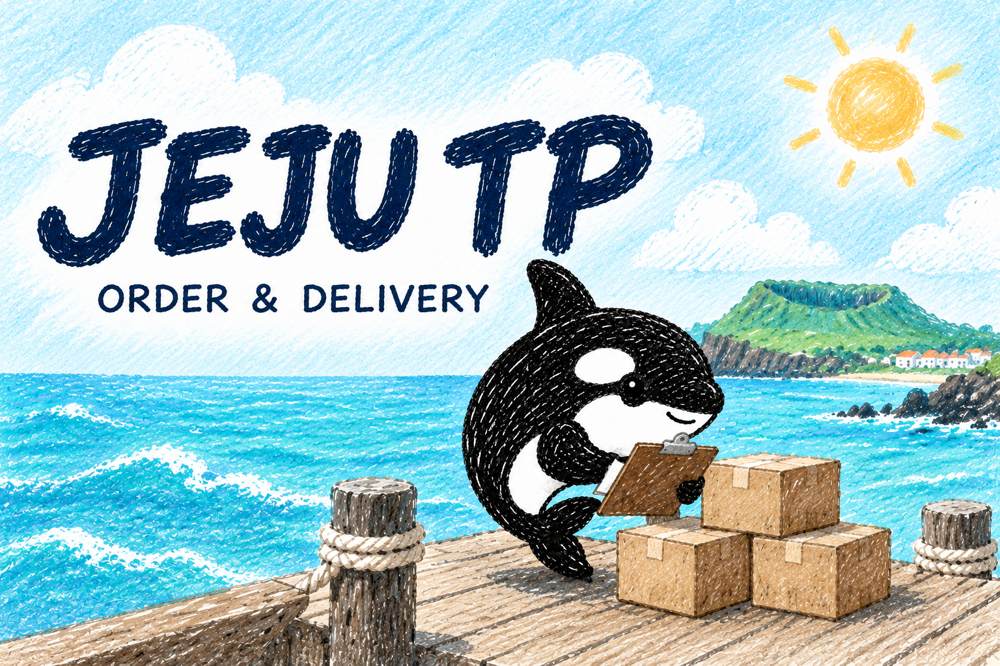
<h3>03. 제&#8288;주&#8288;TP 연&#8288;계 주&#8288;문&#8288;배&#8288;송&nbsp;관&#8288;리</h3>

<strong>기&#8288;간</strong> 2026.04 - 2026.10

직&#8288;원&#8288;들&#8288;이 요&#8288;청&#8288;한 세&#8288;밀&#8288;한 필&#8288;터 조&#8288;건&#8288;을 반&#8288;영&#8288;해 주&#8288;문 접&#8288;수&#8288;와 배&#8288;송 및 재&#8288;고 관&#8288;리 웹&#8288;서&#8288;비&#8288;스&#8288;를 직&#8288;접 개&#8288;발&#8288;했&#8288;습&#8288;니&#8288;다. 필&#8288;터 때&#8288;문&#8288;에 합&#8288;배&#8288;송&#8288;에 필&#8288;요&#8288;한 주&#8288;문&#8288;이 빠&#8288;지&#8288;지 않&#8288;도&#8288;록 연&#8288;관 주&#8288;문 구&#8288;성&#8288;과 합&#8288;배&#8288;송 판&#8288;정&#8288;을 마&#8288;친 뒤 화&#8288;면 필&#8288;터&#8288;를 적&#8288;용&#8288;했&#8288;습&#8288;니&#8288;다.

<h4>주&#8288;요&nbsp;결&#8288;과</h4>
<ul><li><strong>운&#8288;송&#8288;장 매&#8288;칭 화&#8288;면 초&#8288;기 표&#8288;시 32.176&#8288;초 → 1.862&#8288;초</strong> 전&#8288;체 목&#8288;록&#8288;을 스&#8288;크&#8288;롤&#8288;로 확&#8288;인&#8288;하&#8288;는 요&#8288;구&#8288;를 지&#8288;키&#8288;면&#8288;서 필&#8288;요&#8288;한 구&#8288;간&#8288;부&#8288;터 점&#8288;진&#8288;적&#8288;으&#8288;로 조&#8288;회&#8288;하&#8288;도&#8288;록 바&#8288;꿨&#8288;습&#8288;니&#8288;다. 전&#8288;체 목&#8288;록&#8288;을 순&#8288;회&#8288;하&#8288;며 중&#8288;복&#8288;과 누&#8288;락 및 정&#8288;렬 순&#8288;서&#8288;를 검&#8288;증&#8288;했&#8288;습&#8288;니&#8288;다.</li><li><strong>정&#8288;확 집&#8288;계 6.815&#8288;초 → 3.214&#8288;초</strong> 오&#8288;차&#8288;가 관&#8288;측&#8288;된 근&#8288;사 집&#8288;계&#8288;를 기&#8288;각&#8288;하&#8288;고, 조&#8288;회&#8288;마&#8288;다 Painless 스&#8288;크&#8288;립&#8288;트&#8288;로 묶&#8288;음 기&#8288;준 키&#8288;를 반&#8288;복 계&#8288;산&#8288;하&#8288;는 대&#8288;신 저&#8288;장 시&#8288;점&#8288;에 파&#8288;생 keyword 키&#8288;를 미&#8288;리 생&#8288;성&#8288;해 doc_values&#8288;로 조&#8288;회&#8288;하&#8288;도&#8288;록 전&#8288;환. 기&#8288;존 문&#8288;서 백&#8288;필 전&#8288;후&#8288;의 데&#8288;이&#8288;터 일&#8288;치&#8288;를 검&#8288;증&#8288;하&#8288;고 정&#8288;확 집&#8288;계 시&#8288;간&#8288;을 6.815&#8288;초&#8288;에&#8288;서 3.214&#8288;초&#8288;로&nbsp;단&#8288;축</li><li><strong>규&#8288;칙&#8288;과 AI&#8288;를 나&#8288;눈 배&#8288;송&#8288;메&#8288;시&#8288;지&nbsp;처&#8288;리</strong> 날&#8288;짜&#8288;와 발&#8288;송&#8288;인 등 확&#8288;정&#8288;할 수 있&#8288;는 항&#8288;목&#8288;은 규&#8288;칙&#8288;으&#8288;로 처&#8288;리&#8288;했&#8288;습&#8288;니&#8288;다. 불&#8288;확&#8288;실&#8288;한 내&#8288;용&#8288;은 Kanana&#8288;로 추&#8288;론&#8288;한 뒤 사&#8288;람&#8288;이 검&#8288;수&#8288;하&#8288;도&#8288;록 구&#8288;성&#8288;했&#8288;습&#8288;니&#8288;다.</li></ul>

<strong>사&#8288;용&nbsp;기&#8288;술</strong>    

업&#8288;무 프&#8288;로&#8288;젝&#8288;트 / 코&#8288;드&nbsp;비&#8288;공&#8288;개

</td></tr>
</table>

<table align="left" width="400">
<tr><td width="400" valign="top">

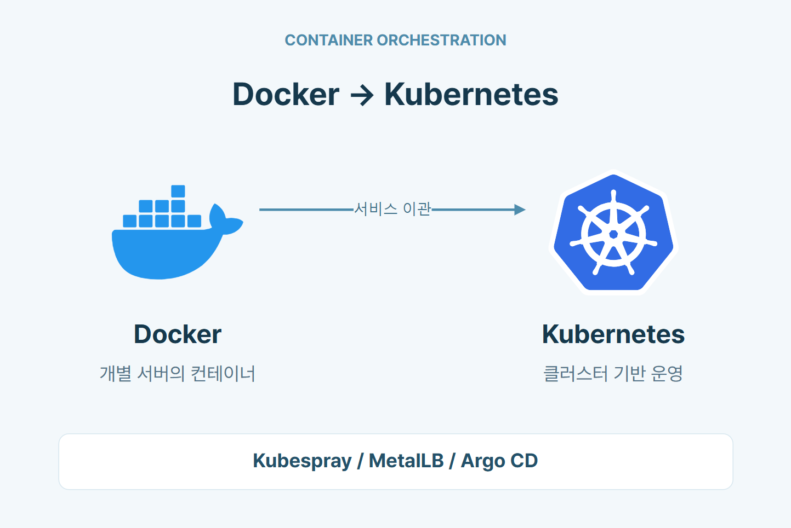
<h3>04. Kubernetes 클&#8288;러&#8288;스&#8288;터 구&#8288;축 및 서&#8288;비&#8288;스&nbsp;이&#8288;관</h3>

<strong>수&#8288;행&nbsp;경&#8288;력</strong> 2025.09 -&nbsp;현&#8288;재

서&#8288;버 자&#8288;원&#8288;을 통&#8288;합 관&#8288;리&#8288;하&#8288;고 서&#8288;비&#8288;스 배&#8288;치&#8288;를 개&#8288;선&#8288;하&#8288;기 위&#8288;해 Kubernetes 전&#8288;환&#8288;을 직&#8288;접 제&#8288;안&#8288;했&#8288;습&#8288;니&#8288;다. Kubespray&#8288;로 클&#8288;러&#8288;스&#8288;터&#8288;를 구&#8288;축&#8288;하&#8288;고 기&#8288;존 컨&#8288;테&#8288;이&#8288;너 서&#8288;비&#8288;스&#8288;를 모&#8288;두 이&#8288;관&#8288;했&#8288;습&#8288;니&#8288;다.

<h4>주&#8288;요&nbsp;결&#8288;과</h4>
<ul><li><strong>사&#8288;용&#8288;자 작&#8288;업&#8288;을 보&#8288;존&#8288;하&#8288;는 배&#8288;포&nbsp;구&#8288;성</strong> 
무&#8288;상&#8288;태 서&#8288;비&#8288;스&#8288;는 RollingUpdate&#8288;로, 동&#8288;시 쓰&#8288;기&#8288;가 제&#8288;한&#8288;된 RBD 단&#8288;일 워&#8288;크&#8288;로&#8288;드&#8288;는 Recreate&#8288;로 배&#8288;포 전&#8288;략&#8288;을 구&#8288;분. 사&#8288;용 중&#8288;인 런&#8288;타&#8288;임&#8288;은 교&#8288;체&#8288;를 보&#8288;류&#8288;해 작&#8288;업&nbsp;보&#8288;호

GitLab CI&#8288;에&#8288;서 검&#8288;증&#8288;한 이&#8288;미&#8288;지 digest&#8288;를 운&#8288;영 승&#8288;격&#8288;까&#8288;지 그&#8288;대&#8288;로 유&#8288;지. 변&#8288;경&#8288;된 컴&#8288;포&#8288;넌&#8288;트 매&#8288;니&#8288;페&#8288;스&#8288;트&#8288;만 갱&#8288;신&#8288;해 Argo CD&#8288;로 배&#8288;포 정&#8288;합&#8288;성&nbsp;확&#8288;보
</li><li><strong>상&#8288;태 확&#8288;인 실&#8288;패&#8288;에 따&#8288;른 반&#8288;복 재&#8288;시&#8288;작&nbsp;해&#8288;결</strong> 상&#8288;태 확&#8288;인 요&#8288;청&#8288;이 인&#8288;증&#8288;에&#8288;서 차&#8288;단&#8288;되&#8288;는 원&#8288;인&#8288;을 찾&#8288;아 해&#8288;당 경&#8288;로&#8288;만 인&#8288;증 예&#8288;외&#8288;로 분&#8288;리&#8288;했&#8288;습&#8288;니&#8288;다. 상&#8288;태 확&#8288;인&#8288;의 정&#8288;상 응&#8288;답&#8288;과 일&#8288;반 API&#8288;의 인&#8288;증 유&#8288;지&#8288;를 검&#8288;증&#8288;했&#8288;습&#8288;니&#8288;다.</li><li><strong>운&#8288;영 절&#8288;차 문&#8288;서&#8288;화&#8288;와&nbsp;공&#8288;유</strong> 다&#8288;른 사&#8288;람&#8288;이 운&#8288;영 작&#8288;업&#8288;을 따&#8288;라 할 수 있&#8288;도&#8288;록 Headlamp 사&#8288;용&#8288;법&#8288;과 CLI 명&#8288;령&#8288;어&#8288;를 포&#8288;함&#8288;한 작&#8288;업 순&#8288;서&#8288;와 확&#8288;인 방&#8288;법&#8288;을 문&#8288;서&#8288;로 정&#8288;리&#8288;해 공&#8288;유&#8288;했&#8288;습&#8288;니&#8288;다.</li></ul>

<strong>사&#8288;용&nbsp;기&#8288;술</strong>       

업&#8288;무 프&#8288;로&#8288;젝&#8288;트 / 코&#8288;드&nbsp;비&#8288;공&#8288;개

</td></tr>
</table>

 

<table align="left" width="400">
<tr><td width="400" valign="top">

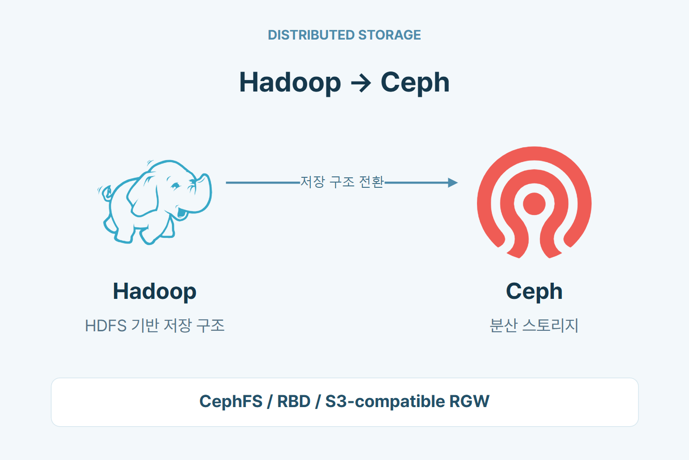
<h3>05. Ceph 분&#8288;산 스&#8288;토&#8288;리&#8288;지 구&#8288;축 및 데&#8288;이&#8288;터&nbsp;이&#8288;관</h3>

<strong>수&#8288;행&nbsp;경&#8288;력</strong> 2025.09 -&nbsp;현&#8288;재

Hadoop 기&#8288;반 저&#8288;장 환&#8288;경&#8288;을 Ceph&#8288;로 전&#8288;환&#8288;하&#8288;고 Kubernetes 서&#8288;비&#8288;스&#8288;의 저&#8288;장&#8288;소&#8288;를 구&#8288;성&#8288;했&#8288;습&#8288;니&#8288;다.

<h4>주&#8288;요&nbsp;결&#8288;과</h4>
<ul><li><strong>서&#8288;비&#8288;스 구&#8288;조&#8288;에 맞&#8288;춘 저&#8288;장&#8288;소 구&#8288;축&#8288;과&nbsp;이&#8288;관</strong> Ceph 분&#8288;산 스&#8288;토&#8288;리&#8288;지&#8288;를 구&#8288;축&#8288;하&#8288;고 서&#8288;비&#8288;스&#8288;별 내&#8288;부 아&#8288;키&#8288;텍&#8288;처&#8288;에 맞&#8288;춰 RBD&#8288;와 CephFS 및 RGW 이&#8288;관 계&#8288;획&#8288;을 세&#8288;우&#8288;고 데&#8288;이&#8288;터&#8288;를 이&#8288;관&#8288;했&#8288;습&#8288;니&#8288;다.</li></ul>

<strong>사&#8288;용&nbsp;기&#8288;술</strong>      

업&#8288;무 프&#8288;로&#8288;젝&#8288;트 / 코&#8288;드&nbsp;비&#8288;공&#8288;개

</td></tr>
</table>

<table align="left" width="400">
<tr><td width="400" valign="top">

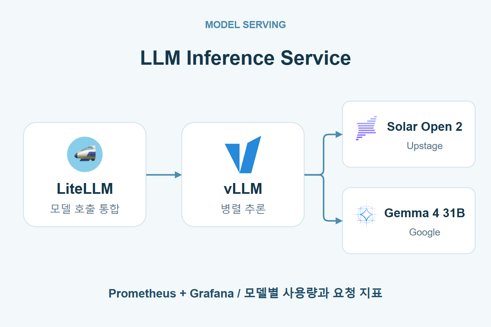
<h3>06. vLLM 기&#8288;반 LLM 추&#8288;론&nbsp;서&#8288;비&#8288;스</h3>

<strong>수&#8288;행&nbsp;경&#8288;력</strong> 2025.09 -&nbsp;현&#8288;재

내&#8288;부 자&#8288;료&#8288;를 외&#8288;부&#8288;에 보&#8288;내&#8288;지 않&#8288;고 AI&#8288;를 활&#8288;용&#8288;할 수 있&#8288;도&#8288;록 vLLM 추&#8288;론 서&#8288;비&#8288;스&#8288;를 구&#8288;축&#8288;하&#8288;고 LiteLLM 공&#8288;통 API&#8288;로 모&#8288;델 호&#8288;출&#8288;을 통&#8288;합&#8288;했&#8288;습&#8288;니&#8288;다. Solar Open 2&#8288;와 Gemma 4 31B IT 및 GPT-OSS 120B&#8288;를 서&#8288;빙&#8288;했&#8288;습&#8288;니&#8288;다.

<h4>주&#8288;요&nbsp;결&#8288;과</h4>
<ul><li><strong>긴 입&#8288;력&#8288;으&#8288;로 인&#8288;한 후&#8288;속 요&#8288;청 대&#8288;기&nbsp;분&#8288;석</strong> 
긴 요&#8288;청 뒤&#8288;의 짧&#8288;은 요&#8288;청&#8288;까&#8288;지 함&#8288;께 대&#8288;기&#8288;하&#8288;는 원&#8288;인&#8288;이 허&#8288;용 컨&#8288;텍&#8288;스&#8288;트 설&#8288;정&#8288;과 실&#8288;제 KV 수&#8288;용&#8288;량&#8288;의 차&#8288;이, 전&#8288;체 입&#8288;력&#8288;을 미&#8288;리 예&#8288;약&#8288;하&#8288;는 정&#8288;책&#8288;에 있&#8288;음&#8288;을 분&#8288;석. 입&#8288;력 예&#8288;약 옵&#8288;션&#8288;을 조&#8288;정&#8288;해 장&#8288;문&#8288;과 단&#8288;문&#8288;이 섞&#8288;인 동&#8288;시 요&#8288;청&#8288;의 처&#8288;리&#8288;를 확&#8288;인&#8288;하&#8288;고 대&#8288;기&#8288;열&nbsp;해&#8288;소

이&#8288;와 별&#8288;도&#8288;로 GPT-OSS 120B&#8288;의 실&#8288;제 출&#8288;력 길&#8288;이&#8288;를 반&#8288;영&#8288;해 처&#8288;리&#8288;량&#8288;과 첫 토&#8288;큰 지&#8288;연&#8288;을 비&#8288;교&#8288;하&#8288;고, 처&#8288;리&#8288;량&#8288;이 높&#8288;아&#8288;도 응&#8288;답 시&#8288;작&#8288;이 항&#8288;상 빠&#8288;르&#8288;지&#8288;는 않&#8288;음&#8288;을&nbsp;확&#8288;인
</li><li><strong>실&#8288;패&#8288;가 발&#8288;생&#8288;한 계&#8288;층&nbsp;구&#8288;분</strong> Prometheus&#8288;와 Grafana 지&#8288;표&#8288;를 로&#8288;그&#8288;와 대&#8288;조&#8288;해 플&#8288;랫&#8288;폼&#8288;과 서&#8288;버 간 호&#8288;출 및 모&#8288;델 추&#8288;론 중 어&#8288;느 계&#8288;층&#8288;에&#8288;서 실&#8288;패&#8288;했&#8288;는&#8288;지 구&#8288;분&#8288;했&#8288;습&#8288;니&#8288;다.</li></ul>

<strong>사&#8288;용&nbsp;기&#8288;술</strong>      

업&#8288;무 프&#8288;로&#8288;젝&#8288;트 / 코&#8288;드&nbsp;비&#8288;공&#8288;개

</td></tr>
</table>

 

<a href="#projects">프&#8288;로&#8288;젝&#8288;트 목&#8288;차 ↑</a>

### 3.2 Apps

<a href="#project-07">07. Replant</a> 
<a href="#project-08">08. 가&#8288;야&#8288;디 / Gayadi</a> 
<a href="#project-09">09. Chickadee Studio</a>

<table align="left" width="400">
<tr><td width="400" valign="top">

<h3>07. Replant</h3>

<strong>기&#8288;간</strong> 2025.09 - 2026.02 / PM, 백&#8288;엔&#8288;드&nbsp;개&#8288;발

사&#8288;회&#8288;적 고&#8288;립&#8288;을 겪&#8288;는 사&#8288;용&#8288;자&#8288;의 일&#8288;상 회&#8288;복&#8288;을 돕&#8288;는 앱&#8288;에&#8288;서 PM&#8288;과 백&#8288;엔&#8288;드 개&#8288;발&#8288;을 맡&#8288;았&#8288;습&#8288;니&#8288;다. 게&#8288;임&#8288;과 라&#8288;이&#8288;프&#8288;케&#8288;어 중 서&#8288;비&#8288;스 방&#8288;향&#8288;을 논&#8288;의&#8288;할 때 라&#8288;이&#8288;프&#8288;케&#8288;어&#8288;를 지&#8288;지&#8288;했&#8288;습&#8288;니&#8288;다. 팀&#8288;과 합&#8288;의&#8288;해 일&#8288;상 회&#8288;복&#8288;을 중&#8288;심&#8288;에 두&#8288;고 미&#8288;션&#8288;과 감&#8288;정 기&#8288;록&#8288;에 캐&#8288;릭&#8288;터 성&#8288;장 요&#8288;소&#8288;를 연&#8288;결&#8288;했&#8288;습&#8288;니&#8288;다.

캐&#8288;릭&#8288;터&#8288;와 대&#8288;화&#8288;하&#8288;는 기&#8288;능&#8288;이 외&#8288;부 AI 호&#8288;출 실&#8288;패&#8288;로 끊&#8288;기&#8288;지 않&#8288;도&#8288;록 Gemini 2.0 Flash&#8288;를 우&#8288;선 사&#8288;용&#8288;하&#8288;고 로&#8288;컬 Qwen2.5-7B&#8288;를 대&#8288;체 경&#8288;로&#8288;로 뒀&#8288;습&#8288;니&#8288;다. Spring AI&#8288;로 두 호&#8288;출 경&#8288;로&#8288;를 연&#8288;결&#8288;하&#8288;고 Qwen&#8288;은 vLLM&#8288;으&#8288;로 서&#8288;빙&#8288;했&#8288;습&#8288;니&#8288;다. 출&#8288;시 뒤&#8288;에&#8288;는 사&#8288;용&#8288;자&#8288;와 직&#8288;접 대&#8288;화&#8288;하&#8288;는 일&#8288;의 필&#8288;요&#8288;성&#8288;도 느&#8288;껴 후&#8288;속 앱 가&#8288;야&#8288;디&#8288;에&#8288;서 직&#8288;접 홍&#8288;보&#8288;하&#8288;며 개&#8288;선 의&#8288;견&#8288;을 들&#8288;었&#8288;습&#8288;니&#8288;다.

<h4>주&#8288;요&nbsp;결&#8288;과</h4>
<ul><li><strong>앱 출&#8288;시 및 배&#8288;리&#8288;어&#8288;프&#8288;리 공&#8288;모&#8288;전 최&#8288;종&nbsp;발&#8288;표</strong> PM&#8288;과 백&#8288;엔&#8288;드 개&#8288;발&#8288;을 맡&#8288;아 앱&#8288;을 출&#8288;시&#8288;하&#8288;고 공&#8288;모&#8288;전 최&#8288;종 발&#8288;표&#8288;까&#8288;지 진&#8288;행&#8288;했&#8288;습&#8288;니&#8288;다.</li><li><strong>외&#8288;부 AI 호&#8288;출 실&#8288;패&#8288;에 대&#8288;응&#8288;하&#8288;는 대&#8288;체 경&#8288;로&nbsp;구&#8288;현</strong> Gemini 호&#8288;출&#8288;에 실&#8288;패&#8288;하&#8288;면 로&#8288;컬 Qwen 모&#8288;델&#8288;로 전&#8288;환&#8288;하&#8288;도&#8288;록 구&#8288;성&#8288;했&#8288;습&#8288;니&#8288;다.</li></ul>

<strong>사&#8288;용&nbsp;기&#8288;술</strong>      

<a href="#architecture-07">아&#8288;키&#8288;텍&#8288;처 보&#8288;기 ↓</a>

</td></tr>
</table>

<table align="left" width="400">
<tr><td width="400" valign="top">

<h3>08. 가&#8288;야&#8288;디 / Gayadi</h3>

<strong>기&#8288;간</strong> 2026.08 - 2026.09 / 백&#8288;엔&#8288;드, AI 서&#8288;비&#8288;스&nbsp;개&#8288;발

일&#8288;행&#8288;의 성&#8288;향&#8288;과 관&#8288;광&#8288;지 정&#8288;보&#8288;를 바&#8288;탕&#8288;으&#8288;로 여&#8288;행 일&#8288;정&#8288;을 추&#8288;천&#8288;하&#8288;고, 날&#8288;씨&#8288;와 혼&#8288;잡&#8288;도 변&#8288;화&#8288;에 따&#8288;라 대&#8288;안&#8288;을 제&#8288;안&#8288;하&#8288;는 앱&#8288;을 개&#8288;발&#8288;했&#8288;습&#8288;니&#8288;다. Spring Boot&#8288;의 일&#8288;정 API&#8288;에 관&#8288;광 정&#8288;보&#8288;와 상&#8288;황 정&#8288;보 및 Spring AI 기&#8288;반 추&#8288;천&#8288;을 연&#8288;결&#8288;해 후&#8288;보&#8288;를 제&#8288;안&#8288;하&#8288;는 과&#8288;정&#8288;과 실&#8288;제 일&#8288;정&#8288;을 수&#8288;정&#8288;하&#8288;는 과&#8288;정&#8288;을 나&#8288;눴&#8288;습&#8288;니&#8288;다.

AI&#8288;가 변&#8288;경&#8288;안&#8288;을 만&#8288;드&#8288;는 동&#8288;안 일&#8288;행&#8288;이 일&#8288;정&#8288;을 수&#8288;정&#8288;하&#8288;면 이&#8288;전 상&#8288;태&#8288;를 바&#8288;탕&#8288;으&#8288;로 한 제&#8288;안&#8288;이 최&#8288;신 일&#8288;정&#8288;을 덮&#8288;어&#8288;쓸 수 있&#8288;었&#8288;습&#8288;니&#8288;다. 변&#8288;경&#8288;안&#8288;에 일&#8288;정 버&#8288;전&#8288;을 기&#8288;록&#8288;하&#8288;고 승&#8288;인 시 현&#8288;재 버&#8288;전&#8288;과 대&#8288;조&#8288;했&#8288;습&#8288;니&#8288;다. 버&#8288;전&#8288;이 맞&#8288;을 때&#8288;만 반&#8288;영&#8288;한 뒤 이&#8288;동&#8288;경&#8288;로&#8288;를 다&#8288;시 계&#8288;산&#8288;하&#8288;도&#8288;록 구&#8288;현&#8288;했&#8288;습&#8288;니&#8288;다.

<h4>주&#8288;요&nbsp;결&#8288;과</h4>
<ul><li><strong>여&#8288;행 일&#8288;정 추&#8288;천 앱 개&#8288;발 및&nbsp;출&#8288;시</strong> 성&#8288;향 설&#8288;문&#8288;과 관&#8288;광, 날&#8288;씨, 혼&#8288;잡&#8288;도 정&#8288;보&#8288;를 연&#8288;결&#8288;해 일&#8288;정&#8288;과 대&#8288;안&#8288;을 추&#8288;천&#8288;하&#8288;는 백&#8288;엔&#8288;드&#8288;와 AI 서&#8288;비&#8288;스&#8288;를 개&#8288;발&#8288;했&#8288;습&#8288;니&#8288;다.</li><li><strong>오&#8288;래&#8288;된 AI 제&#8288;안&#8288;의 최&#8288;신 일&#8288;정 덮&#8288;어&#8288;쓰&#8288;기&nbsp;방&#8288;지</strong> 사&#8288;용&#8288;자&#8288;가 변&#8288;경&#8288;안&#8288;을 승&#8288;인&#8288;할 때 일&#8288;정 버&#8288;전&#8288;을 확&#8288;인&#8288;하&#8288;고 일&#8288;치&#8288;하&#8288;는 경&#8288;우&#8288;에&#8288;만 반&#8288;영&#8288;했&#8288;습&#8288;니&#8288;다. 반&#8288;영 뒤&#8288;에&#8288;는 이&#8288;동&#8288;경&#8288;로&#8288;를 다&#8288;시 계&#8288;산&#8288;하&#8288;도&#8288;록 구&#8288;현&#8288;했&#8288;습&#8288;니&#8288;다.</li></ul>

<strong>사&#8288;용&nbsp;기&#8288;술</strong>     

<a href="#architecture-08">아&#8288;키&#8288;텍&#8288;처 보&#8288;기 ↓</a>

</td></tr>
</table>

<table align="left" width="400">
<tr><td width="400" valign="top">

<h3>09. Chickadee Studio</h3>

<strong>기&#8288;간</strong> 2026.10 / 팀 프&#8288;로&#8288;젝&#8288;트

공&#8288;공 웹&#8288;사&#8288;이&#8288;트&#8288;의 게&#8288;시&#8288;글&#8288;과 댓&#8288;글 및 이&#8288;미&#8288;지&#8288;에&#8288;서 위&#8288;장 광&#8288;고&#8288;를 탐&#8288;지&#8288;하&#8288;고 판&#8288;단 근&#8288;거&#8288;를 검&#8288;토&#8288;하&#8288;는 오&#8288;픈&#8288;소&#8288;스 데&#8288;스&#8288;크&#8288;톱 앱&#8288;입&#8288;니&#8288;다. 팀 프&#8288;로&#8288;젝&#8288;트&#8288;에&#8288;서 웹 수&#8288;집 탐&#8288;지 엔&#8288;진 개&#8288;발&#8288;과 OCR 모&#8288;델 연&#8288;동 및 광&#8288;고 탐&#8288;지 모&#8288;델&#8288;의 학&#8288;습&#8288;과 평&#8288;가&#8288;를 담&#8288;당&#8288;했&#8288;습&#8288;니&#8288;다.

Playwright&#8288;로 페&#8288;이&#8288;지 본&#8288;문&#8288;과 댓&#8288;글 및 iframe 요&#8288;소&#8288;를 수&#8288;집&#8288;하&#8288;고 닮&#8288;은&#8288;꼴 문&#8288;자 치&#8288;환&#8288;이&#8288;나 화&#8288;면 밖 숨&#8288;김 같&#8288;은 우&#8288;회 표&#8288;기&#8288;를 잡&#8288;아&#8288;내&#8288;는 Python 탐&#8288;지 엔&#8288;진&#8288;을 구&#8288;현&#8288;했&#8288;습&#8288;니&#8288;다. 본&#8288;문 텍&#8288;스&#8288;트&#8288;는 바&#8288;로 분&#8288;석&#8288;하&#8288;고 이&#8288;미&#8288;지&#8288;가 포&#8288;함&#8288;된 영&#8288;역&#8288;은 필&#8288;요&#8288;할 때&#8288;만 PaddleOCR&#8288;을 연&#8288;동&#8288;해 문&#8288;구&#8288;를 추&#8288;출&#8288;하&#8288;도&#8288;록 구&#8288;성&#8288;했&#8288;으&#8288;며 본&#8288;문 텍&#8288;스&#8288;트&#8288;와 OCR 추&#8288;출 문&#8288;구&#8288;의 입&#8288;력 출&#8288;처&#8288;를 구&#8288;분&#8288;하&#8288;고 OCR&#8288;로 추&#8288;출&#8288;한 문&#8288;구&#8288;에&#8288;는 원&#8288;본 이&#8288;미&#8288;지 및 글&#8288;자 좌&#8288;표 근&#8288;거&#8288;를 연&#8288;결&#8288;했&#8288;습&#8288;니&#8288;다.

위&#8288;장 광&#8288;고 문&#8288;맥&#8288;을 판&#8288;별&#8288;하&#8288;는 분&#8288;류 모&#8288;델&#8288;의 학&#8288;습&#8288;과 평&#8288;가&#8288;를 수&#8288;행&#8288;해 탐&#8288;지 엔&#8288;진&#8288;에 연&#8288;결&#8288;했&#8288;습&#8288;니&#8288;다.

<strong>사&#8288;용&nbsp;기&#8288;술</strong>   

<a href="https://github.com/orqan137/chickadee_studio">GitHub ↗</a> / <a href="https://github.com/orqan137/chickadee_studio/releases/latest">Windows 다&#8288;운&#8288;로&#8288;드 ↗</a> <a href="https://github.com/orqan137/chickadee_studio/blob/main/docs/architecture.md">아&#8288;키&#8288;텍&#8288;처 보&#8288;기 ↗</a> / <a href="https://github.com/orqan137/chickadee_studio/blob/main/docs/quickstart-windows.md">사&#8288;용&#8288;설&#8288;명&#8288;서 ↗</a>

<a href="#architecture-09">09.1 아키텍처 ↓</a>

</td></tr>
</table>

 

<strong>07. Replant / 아&#8288;키&#8288;텍&#8288;처</strong>

<a href="./assets/replant-service.drawio.png">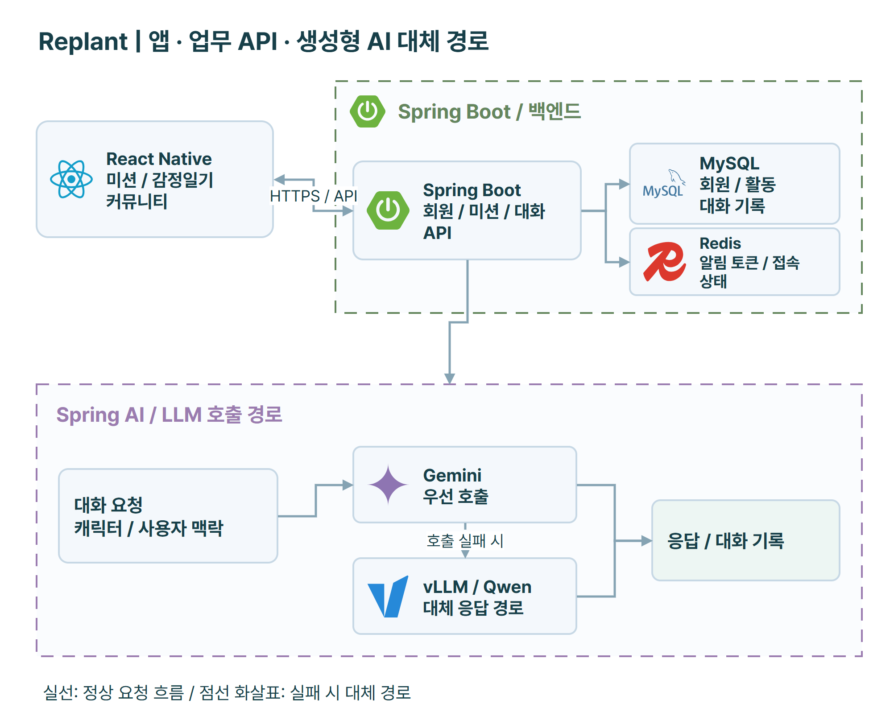</a>

<a href="./assets/replant-service.drawio.png">도&#8288;식 크&#8288;게 보&#8288;기 ↗</a> / <a href="#project-07">프&#8288;로&#8288;젝&#8288;트 설&#8288;명 ↑</a>

<strong>08. 가&#8288;야&#8288;디 / Gayadi / 아&#8288;키&#8288;텍&#8288;처</strong>

<a href="./assets/gayadi-trip-and-ai.drawio.png">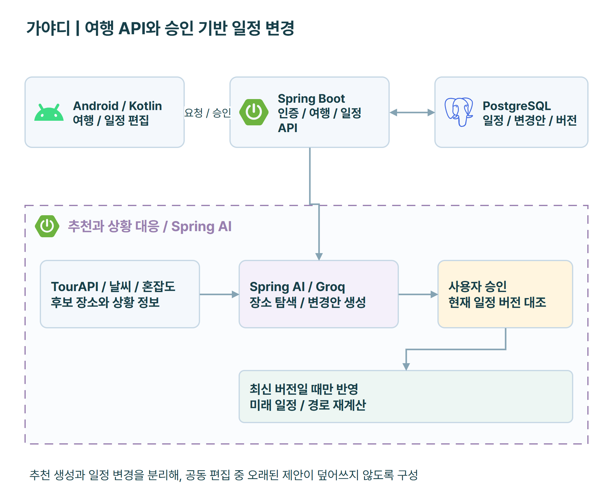</a>

<a href="./assets/gayadi-trip-and-ai.drawio.png">도&#8288;식 크&#8288;게 보&#8288;기 ↗</a> / <a href="#project-08">프&#8288;로&#8288;젝&#8288;트 설&#8288;명 ↑</a>

<a href="#projects">프&#8288;로&#8288;젝&#8288;트 목&#8288;차 ↑</a>

<strong>09.1 Chickadee Studio / 아키텍처</strong>

<a href="./assets/chickadee-architecture.png">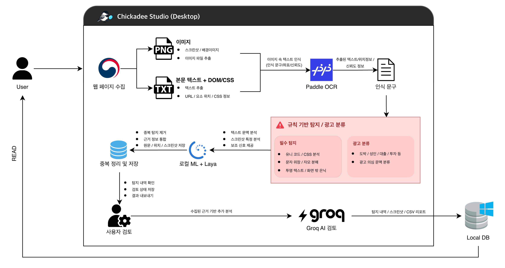</a>

<a href="./assets/chickadee-architecture.png">도식 크게 보기 ↗</a> / <a href="#project-09">프로젝트 설명 ↑</a>

### 3.3 AI Challenges

<a href="#project-10">10. SCPC 2026 AI Challenge</a> 
<a href="#project-11">11. 연&#8288;금 어&#8288;드&#8288;바&#8288;이&#8288;저 / mirae_pj</a> 
<a href="#project-12">12. TREC 2024 Product Search</a> 
<a href="#project-13">13. TREC 2025 Product Search &amp; Recommendations</a>

<table align="left" width="400">
<tr><td width="400" valign="top">

<h3>10. SCPC 2026 AI Challenge</h3>

<strong>기&#8288;간</strong> 2026.07 - 2026.08

대&#8288;회 과&#8288;제&#8288;로 실&#8288;행 계&#8288;획&#8288;을 만&#8288;드&#8288;는 Python Agent&#8288;와 공&#8288;유 조&#8288;건&#8288;을 관&#8288;리&#8288;하&#8288;는 Android 앱 SafeShare&#8288;를 개&#8288;발&#8288;했&#8288;습&#8288;니&#8288;다. Agent&#8288;는 같&#8288;은 내&#8288;용&#8288;이 다&#8288;른 순&#8288;서&#8288;나 형&#8288;식&#8288;으&#8288;로 들&#8288;어&#8288;와&#8288;도 같&#8288;은 규&#8288;칙&#8288;을 적&#8288;용&#8288;하&#8288;도&#8288;록 입&#8288;력&#8288;을 정&#8288;규&#8288;화&#8288;하&#8288;고, 충&#8288;돌&#8288;하&#8288;는 조&#8288;건&#8288;을 확&#8288;인&#8288;한 뒤 실&#8288;행 계&#8288;획&#8288;을 만&#8288;들&#8288;도&#8288;록 구&#8288;성&#8288;했&#8288;습&#8288;니&#8288;다.

SafeShare&#8288;에&#8288;서&#8288;는 이&#8288;전&#8288;에 확&#8288;인&#8288;한 공&#8288;유 조&#8288;건&#8288;을 다&#8288;음 세&#8288;션&#8288;에&#8288;도 활&#8288;용&#8288;하&#8288;되, 목&#8288;적&#8288;과 대&#8288;상, 역&#8288;할&#8288;이&#8288;나 권&#8288;한&#8288;이 달&#8288;라&#8288;지&#8288;면 다&#8288;시 확&#8288;인&#8288;해&#8288;야 했&#8288;습&#8288;니&#8288;다. 공&#8288;유 초&#8288;안&#8288;과 실&#8288;행 상&#8288;태&#8288;를 나&#8288;눠 변&#8288;경&#8288;에 영&#8288;향&#8288;을 받&#8288;는 부&#8288;분&#8288;을 보&#8288;류&#8288;하&#8288;고, 프&#8288;로&#8288;세&#8288;스&#8288;가 재&#8288;시&#8288;작&#8288;돼&#8288;도 확&#8288;인&#8288;한 조&#8288;건&#8288;과 작&#8288;업 상&#8288;태&#8288;를 이&#8288;어&#8288;가&#8288;도&#8288;록 구&#8288;현&#8288;했&#8288;습&#8288;니&#8288;다.

<h4>주&#8288;요&nbsp;결&#8288;과</h4>
<ul><li><strong>실&#8288;행 계&#8288;획 Agent&#8288;와 Android 앱&nbsp;구&#8288;현</strong> Python Agent&#8288;와 SafeShare 앱&#8288;을 개&#8288;발&#8288;하&#8288;고 확&#8288;인&#8288;한 공&#8288;유 조&#8288;건&#8288;을 다&#8288;음 세&#8288;션&#8288;에&#8288;서&#8288;도 활&#8288;용&#8288;하&#8288;도&#8288;록 구&#8288;성&#8288;했&#8288;습&#8288;니&#8288;다.</li><li><strong>수&#8288;만 건&#8288;의 자&#8288;체 변&#8288;형 입&#8288;력&nbsp;테&#8288;스&#8288;트</strong> 자&#8288;체 테&#8288;스&#8288;트&#8288;에&#8288;서 예&#8288;외&#8288;와 출&#8288;력 형&#8288;식 위&#8288;반&#8288;이 발&#8288;생&#8288;하&#8288;지 않&#8288;는 것&#8288;을 확&#8288;인&#8288;했&#8288;습&#8288;니&#8288;다.</li></ul>

<strong>사&#8288;용&nbsp;기&#8288;술</strong>   

<a href="#architecture-10">아&#8288;키&#8288;텍&#8288;처 보&#8288;기 ↓</a>

<a href="https://github.com/orqan137/scpc2026">공&#8288;개 저&#8288;장&#8288;소 ↗</a> / <a href="./assets/scpc-safeshare-architecture.png">아&#8288;키&#8288;텍&#8288;처 크&#8288;게 보&#8288;기 ↗</a>

</td></tr>
</table>

<table align="left" width="400">
<tr><td width="400" valign="top">

<h3>11. 연&#8288;금 어&#8288;드&#8288;바&#8288;이&#8288;저 / mirae_pj</h3>

<strong>기&#8288;간</strong> 2026.08 - 2026.09

연&#8288;금 제&#8288;도&#8288;와 세&#8288;금 및 상&#8288;품 관&#8288;련 질&#8288;문&#8288;에 근&#8288;거 자&#8288;료&#8288;와 계&#8288;산 결&#8288;과&#8288;를 제&#8288;공&#8288;하&#8288;는 AI 상&#8288;담 서&#8288;비&#8288;스&#8288;를 단&#8288;독 개&#8288;발&#8288;해 출&#8288;품&#8288;했&#8288;습&#8288;니&#8288;다. 모&#8288;델&#8288;이 수&#8288;치&#8288;를 임&#8288;의&#8288;로 생&#8288;성&#8288;하&#8288;지 않&#8288;도&#8288;록 계&#8288;산&#8288;과 상&#8288;품 비&#8288;교&#8288;는 FastAPI 도&#8288;구 모&#8288;듈&#8288;로 분&#8288;리&#8288;하&#8288;고 HyperCLOVA X&#8288;에&#8288;는 근&#8288;거&#8288;와 계&#8288;산 결&#8288;과&#8288;를 전&#8288;달&#8288;해 설&#8288;명&#8288;을 생&#8288;성&#8288;하&#8288;도&#8288;록 했&#8288;습&#8288;니&#8288;다.

생&#8288;성&#8288;한 답&#8288;변&#8288;의 수&#8288;치&#8288;와 상&#8288;품 정&#8288;보 및 인&#8288;용&#8288;을 원&#8288;문&#8288;과 대&#8288;조&#8288;했&#8288;습&#8288;니&#8288;다.

<h4>주&#8288;요&nbsp;결&#8288;과</h4>
<ul><li><strong>계&#8288;산&#8288;과 상&#8288;품 비&#8288;교&#8288;를 답&#8288;변 생&#8288;성&#8288;에&#8288;서&nbsp;분&#8288;리</strong> 질&#8288;문&#8288;에 맞&#8288;는 근&#8288;거 검&#8288;색&#8288;과 계&#8288;산 및 상&#8288;품 비&#8288;교 결&#8288;과&#8288;를 모&#8288;델&#8288;에 전&#8288;달&#8288;하&#8288;는 상&#8288;담 파&#8288;이&#8288;프&#8288;라&#8288;인&#8288;을 구&#8288;현&#8288;했&#8288;습&#8288;니&#8288;다.</li><li><strong>답&#8288;변 검&#8288;증 실&#8288;패 시 후&#8288;속 처&#8288;리&nbsp;구&#8288;현</strong> 검&#8288;증 실&#8288;패 시 근&#8288;거&#8288;와 인&#8288;용&#8288;을 보&#8288;완&#8288;해 재&#8288;검&#8288;사&#8288;하&#8288;고 통&#8288;과&#8288;하&#8288;지 못&#8288;하&#8288;면 확&#8288;인&#8288;된 자&#8288;료&#8288;만 발&#8288;췌&#8288;하&#8288;거&#8288;나 답&#8288;변 범&#8288;위&nbsp;축&#8288;소</li></ul>

<strong>사&#8288;용&nbsp;기&#8288;술</strong>    

<a href="#architecture-11">아&#8288;키&#8288;텍&#8288;처 보&#8288;기 ↓</a>

<a href="https://github.com/orqan137/mirae_pj">공&#8288;개 저&#8288;장&#8288;소 ↗</a> / <a href="./assets/mirae-pension-architecture.png">아&#8288;키&#8288;텍&#8288;처 크&#8288;게 보&#8288;기 ↗</a>

</td></tr>
</table>

 

<table align="left" width="400">
<tr><td width="400" valign="top">

<h3>12. TREC 2024 Product Search</h3>

<strong>기&#8288;간</strong> 2024 / JBNU 팀, 공&#8288;동&#8288;저&#8288;자

<strong>TREC 참&#8288;가&nbsp;논&#8288;문</strong> JBNU at TREC 2024 Product Search Track

상&#8288;품 검&#8288;색&#8288;에&#8288;서 검&#8288;색&#8288;어 확&#8288;장&#8288;으&#8288;로 관&#8288;련 없&#8288;는 상&#8288;품&#8288;까&#8288;지 높&#8288;은 순&#8288;위&#8288;에 오&#8288;르&#8288;는 문&#8288;제&#8288;를 다&#8288;룬 공&#8288;동&#8288;연&#8288;구&#8288;입&#8288;니&#8288;다. SPLADE++의 가&#8288;중&#8288;치 계&#8288;산&#8288;을 GELU&#8288;로 바&#8288;꿔 음&#8288;수 가&#8288;중&#8288;치&#8288;를 반&#8288;영&#8288;하&#8288;는 방&#8288;법&#8288;을 실&#8288;험&#8288;했&#8288;습&#8288;니&#8288;다.

상&#8288;품 설&#8288;명&#8288;이 검&#8288;색 모&#8288;델&#8288;의 입&#8288;력 길&#8288;이&#8288;를 넘&#8288;는 문&#8288;제&#8288;에&#8288;는 T5 요&#8288;약&#8288;을 인&#8288;덱&#8288;싱&#8288;에 활&#8288;용&#8288;했&#8288;습&#8288;니&#8288;다. TAS-B&#8288;와 ColBERTv2, 단&#8288;일 모&#8288;델&#8288;과 결&#8288;합 검&#8288;색&#8288;을 비&#8288;교&#8288;해 TREC&#8288;에 팀 실&#8288;험 결&#8288;과&#8288;를 제&#8288;출&#8288;하&#8288;고 공&#8288;동&#8288;저&#8288;자&#8288;로 참&#8288;가 논&#8288;문&#8288;을 작&#8288;성&#8288;했&#8288;습&#8288;니&#8288;다.

<h4>주&#8288;요&nbsp;결&#8288;과</h4>
<ul><li><strong>상&#8288;품 검&#8288;색&#8288;에 맞&#8288;춘 검&#8288;색 모&#8288;델 개&#8288;선&nbsp;연&#8288;구</strong> 공&#8288;동&#8288;연&#8288;구&#8288;에&#8288;서 SPLADE++의 활&#8288;성&#8288;화 함&#8288;수&#8288;를 GELU&#8288;로 변&#8288;경&#8288;해 음&#8288;수 가&#8288;중&#8288;치&#8288;를 반&#8288;영&#8288;하&#8288;고, 관&#8288;련&#8288;성&#8288;이 낮&#8288;은 상&#8288;품&#8288;의 순&#8288;위&#8288;를 조&#8288;정&#8288;하&#8288;는 방&#8288;법&#8288;을 실&#8288;험&#8288;했&#8288;습&#8288;니&#8288;다.</li><li><strong>상&#8288;품 요&#8288;약&#8288;과 검&#8288;색 결&#8288;과 결&#8288;합&nbsp;비&#8288;교</strong> T5&#8288;로 상&#8288;품 설&#8288;명&#8288;을 요&#8288;약&#8288;해 인&#8288;덱&#8288;싱&#8288;하&#8288;고 TAS-B, ColBERTv2&#8288;의 검&#8288;색 결&#8288;과&#8288;를 비&#8288;교&#8288;했&#8288;습&#8288;니&#8288;다. 단&#8288;일 모&#8288;델&#8288;과 검&#8288;색 결&#8288;과 결&#8288;합 방&#8288;식&#8288;을 포&#8288;함&#8288;해 팀&#8288;에&#8288;서 12&#8288;개 실&#8288;험 결&#8288;과&#8288;를 제&#8288;출&#8288;했&#8288;습&#8288;니&#8288;다.</li><li><strong>팀 제&#8288;출 결&#8288;과 NDCG 0.7595 / MAP 0.5805</strong> 논&#8288;문&#8288;에 보&#8288;고&#8288;된 jbnu05&#8288;의 평&#8288;가 결&#8288;과&#8288;입&#8288;니&#8288;다. 상&#8288;품 요&#8288;약&#8288;과 검&#8288;색 모&#8288;델 결&#8288;합&#8288;에 따&#8288;른 결&#8288;과&#8288;를 비&#8288;교&#8288;하&#8288;고, 공&#8288;동&#8288;저&#8288;자&#8288;로 TREC 2024 참&#8288;가 논&#8288;문&#8288;을 작&#8288;성&#8288;했&#8288;습&#8288;니&#8288;다.</li></ul>

<strong>사&#8288;용&nbsp;기&#8288;술</strong>  <kbd>SPLADE++</kbd> <kbd>T5</kbd> <kbd>ColBERTv2</kbd> <kbd>TAS-B</kbd>

<a href="#architecture-12">아&#8288;키&#8288;텍&#8288;처 보&#8288;기 ↓</a>

<a href="https://trec.nist.gov/pubs/trec33/papers/jbnu.product.pdf">TREC 2024 참&#8288;가 논&#8288;문 ↗</a>

</td></tr>
</table>

<table align="left" width="400">
<tr><td width="400" valign="top">

<h3>13. TREC 2025 Product Search &amp; Recommendations</h3>

<strong>기&#8288;간</strong> 2025 / JBNU 팀, 공&#8288;동&#8288;제&#8288;1&#8288;저&#8288;자

<strong>TREC 참&#8288;가&nbsp;논&#8288;문</strong> JBNU at TREC 2025 Product Search and Recommendations Track

검&#8288;색 의&#8288;도&#8288;에 맞&#8288;는 상&#8288;품&#8288;을 찾&#8288;고 대&#8288;체&#8288;재&#8288;와 보&#8288;완&#8288;재&#8288;를 추&#8288;천&#8288;하&#8288;는 TREC 공&#8288;동&#8288;연&#8288;구&#8288;에 참&#8288;여&#8288;해 공&#8288;동&#8288;제&#8288;1&#8288;저&#8288;자&#8288;로 참&#8288;가 논&#8288;문&#8288;을 작&#8288;성&#8288;했&#8288;습&#8288;니&#8288;다. 목&#8288;적&#8288;이 담&#8288;긴 검&#8288;색&#8288;어&#8288;를 단&#8288;어 일&#8288;치&#8288;만&#8288;으&#8288;로 처&#8288;리&#8288;하&#8288;는 한&#8288;계&#8288;를 보&#8288;완&#8288;하&#8288;려&#8288;고 LLM&#8288;이 검&#8288;색 의&#8288;도&#8288;를 Lucene 검&#8288;색&#8288;식&#8288;으&#8288;로 바&#8288;꾸&#8288;는 방&#8288;법&#8288;을 연&#8288;구&#8288;했&#8288;습&#8288;니&#8288;다. 추&#8288;천&#8288;에&#8288;서&#8288;는 후&#8288;보 검&#8288;색&#8288;과 상&#8288;품 관&#8288;계 분&#8288;류&#8288;를 분&#8288;리&#8288;해 대&#8288;체&#8288;재&#8288;와 보&#8288;완&#8288;재&#8288;에 맞&#8288;춰 순&#8288;위&#8288;를 조&#8288;정&#8288;했&#8288;습&#8288;니&#8288;다.

추&#8288;천 실&#8288;험&#8288;에&#8288;서&#8288;는 지&#8288;시&#8288;문 준&#8288;수&#8288;를 고&#8288;려&#8288;해 Qwen3-14B&#8288;를 선&#8288;택&#8288;하&#8288;고 추&#8288;론 비&#8288;용&#8288;을 줄&#8288;이&#8288;기 위&#8288;해 AWQ&#8288;를 적&#8288;용&#8288;했&#8288;습&#8288;니&#8288;다. ModernBERT&#8288;를 이&#8288;용&#8288;한 상&#8288;품 관&#8288;계 분&#8288;류&#8288;와&#8288;도 비&#8288;교&#8288;했&#8288;습&#8288;니&#8288;다. 검&#8288;색 실&#8288;험&#8288;에&#8288;서&#8288;는 텍&#8288;스&#8288;트 질&#8288;의 재&#8288;구&#8288;성&#8288;과 이&#8288;미&#8288;지 정&#8288;보&#8288;를 활&#8288;용&#8288;한 확&#8288;장&#8288;을 각&#8288;각 평&#8288;가&#8288;했&#8288;습&#8288;니&#8288;다.

<h4>주&#8288;요&nbsp;결&#8288;과</h4>
<ul><li><strong>검&#8288;색 의&#8288;도&#8288;를 반&#8288;영&#8288;한 검&#8288;색&#8288;어 재&#8288;구&#8288;성&nbsp;연&#8288;구</strong> LLM&#8288;으&#8288;로 검&#8288;색&#8288;어&#8288;를 Lucene 형&#8288;식&#8288;으&#8288;로 재&#8288;구&#8288;성&#8288;하&#8288;는 방&#8288;법&#8288;과 Qwen2.5-VL&#8288;로 이&#8288;미&#8288;지 정&#8288;보&#8288;를 반&#8288;영&#8288;하&#8288;는 방&#8288;법&#8288;을 비&#8288;교&#8288;했&#8288;습&#8288;니&#8288;다. 팀&#8288;이 제&#8288;출&#8288;한 검&#8288;색 실&#8288;험 중 jbnu-s02&#8288;의 NDCG&#8288;는 0.2911&#8288;로 참&#8288;가 결&#8288;과 중&#8288;앙&#8288;값 0.2832&#8288;를 상&#8288;회&#8288;했&#8288;습&#8288;니&#8288;다.</li><li><strong>상&#8288;품 관&#8288;계 분&#8288;류&#8288;를 활&#8288;용&#8288;한 추&#8288;천 순&#8288;위&nbsp;조&#8288;정</strong> ColBERTv2&#8288;와 SPLADE&#8288;로 후&#8288;보 상&#8288;품&#8288;을 검&#8288;색&#8288;한 뒤 Qwen3-14B 또&#8288;는 ModernBERT&#8288;로 대&#8288;체&#8288;재, 보&#8288;완&#8288;재, 무&#8288;관 상&#8288;품&#8288;을 분&#8288;류&#8288;해 순&#8288;위&#8288;를 다&#8288;시 정&#8288;하&#8288;는 구&#8288;조&#8288;를 연&#8288;구&#8288;했&#8288;습&#8288;니&#8288;다.</li><li><strong>팀 추&#8288;천 결&#8288;과&#8288;와 모&#8288;델&#8288;별 차&#8288;이&nbsp;검&#8288;증</strong> 보&#8288;완&#8288;재 추&#8288;천 jbnu-r01&#8288;은 NDCG@10 0.1864, 대&#8288;체&#8288;재 추&#8288;천 jbnu-r02&#8288;는 0.4927&#8288;을 기&#8288;록&#8288;했&#8288;습&#8288;니&#8288;다. 관&#8288;계 유&#8288;형&#8288;과 평&#8288;가 지&#8288;표&#8288;별&#8288;로 LLM&#8288;과 BERT 기&#8288;반 분&#8288;류 결&#8288;과&#8288;를 비&#8288;교&#8288;했&#8288;습&#8288;니&#8288;다.</li></ul>

<strong>사&#8288;용&nbsp;기&#8288;술</strong>  <kbd>Pyserini</kbd> <kbd>ColBERTv2</kbd>  <kbd>ModernBERT</kbd>

<a href="#architecture-13">아&#8288;키&#8288;텍&#8288;처 보&#8288;기 ↓</a>

<a href="https://trec.nist.gov/pubs/trec34/papers/JBNU.product.pdf">TREC 2025 참&#8288;가 논&#8288;문 ↗</a>

</td></tr>
</table>

 

<strong>10. SCPC 2026 AI Challenge / 아&#8288;키&#8288;텍&#8288;처</strong>

<a href="./assets/scpc-two-rounds.drawio.png">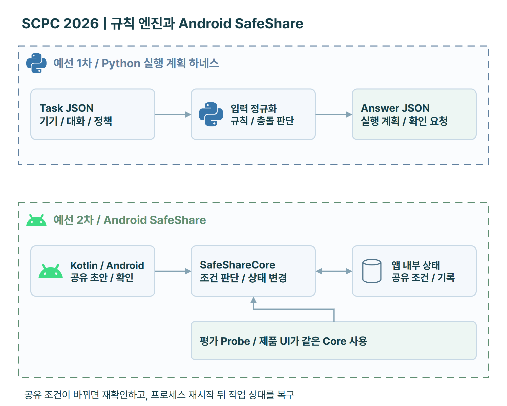</a>

<a href="./assets/scpc-two-rounds.drawio.png">도&#8288;식 크&#8288;게 보&#8288;기 ↗</a> / <a href="#project-10">프&#8288;로&#8288;젝&#8288;트 설&#8288;명 ↑</a>

<strong>11. 연&#8288;금 어&#8288;드&#8288;바&#8288;이&#8288;저 / mirae_pj / 아&#8288;키&#8288;텍&#8288;처</strong>

<a href="./assets/pension-evidence-and-tools.drawio.png">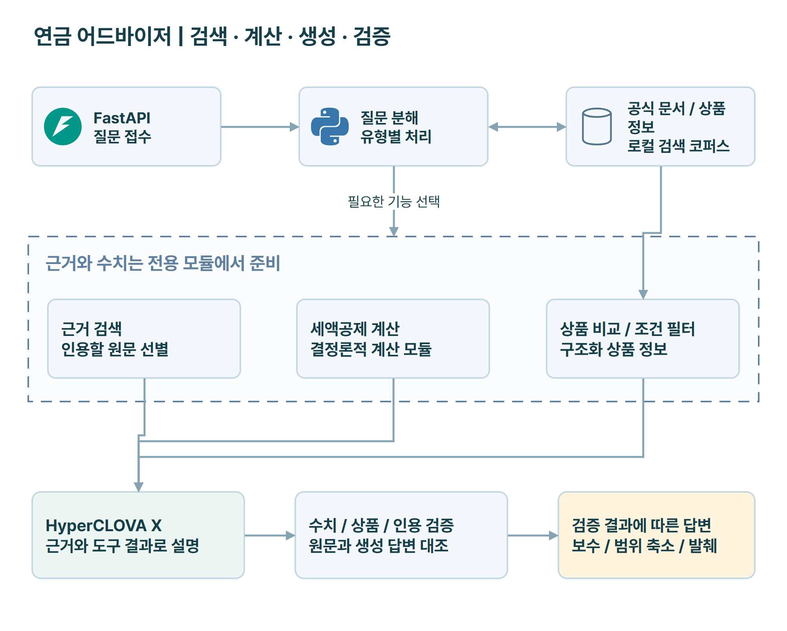</a>

<a href="./assets/pension-evidence-and-tools.drawio.png">도&#8288;식 크&#8288;게 보&#8288;기 ↗</a> / <a href="#project-11">프&#8288;로&#8288;젝&#8288;트 설&#8288;명 ↑</a>

<strong>12. TREC 2024 Product Search / 아&#8288;키&#8288;텍&#8288;처</strong>

<a href="./assets/trec2024-retrieval.drawio.png">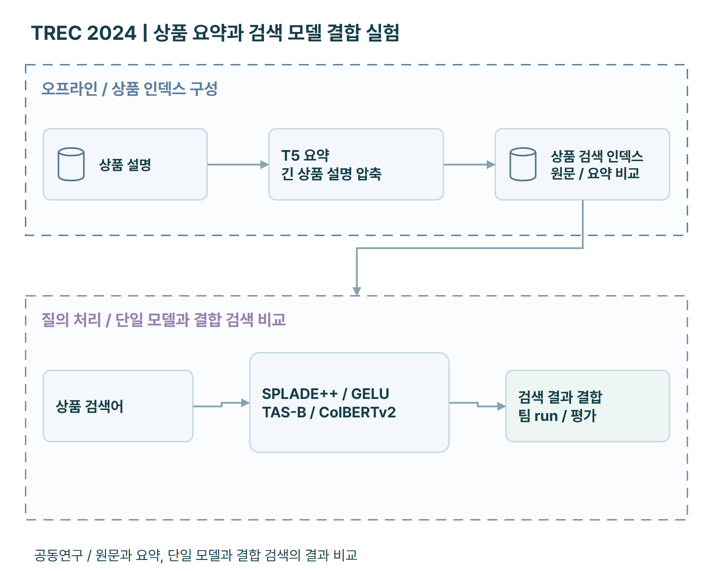</a>

<a href="./assets/trec2024-retrieval.drawio.png">도&#8288;식 크&#8288;게 보&#8288;기 ↗</a> / <a href="#project-12">프&#8288;로&#8288;젝&#8288;트 설&#8288;명 ↑</a>

<strong>13. TREC 2025 Product Search &amp; Recommendations / 아&#8288;키&#8288;텍&#8288;처</strong>

<a href="./assets/trec2025-intent-relations.drawio.png">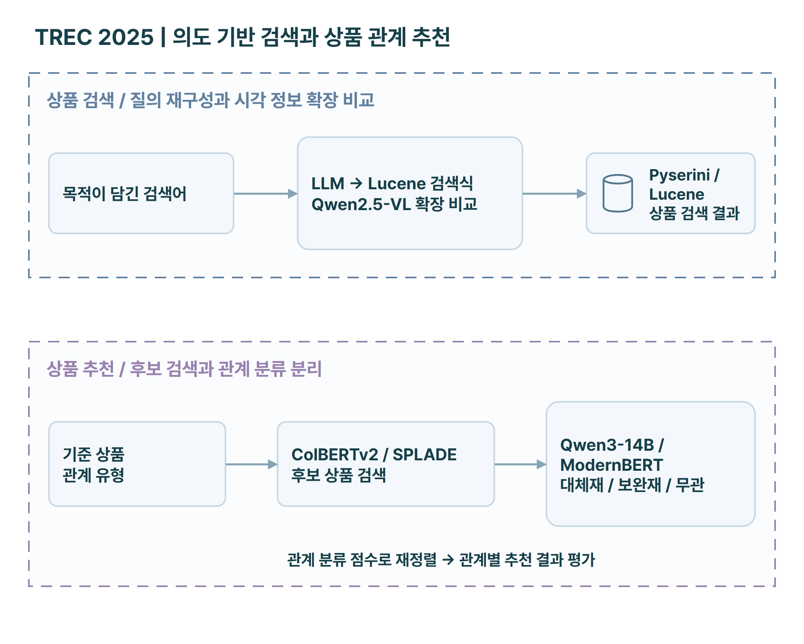</a>

<a href="./assets/trec2025-intent-relations.drawio.png">도&#8288;식 크&#8288;게 보&#8288;기 ↗</a> / <a href="#project-13">프&#8288;로&#8288;젝&#8288;트 설&#8288;명 ↑</a>

<a href="#projects">프&#8288;로&#8288;젝&#8288;트 목&#8288;차 ↑</a>

### 3.4 Campus Projects / 교&#8288;내 프&#8288;로&#8288;젝&#8288;트

<a href="#project-14">14. K-Policy-LLM</a> 
<a href="#project-15">15. AWS 기&#8288;반 미&#8288;국 공&#8288;시 및 뉴&#8288;스 요&#8288;약 서&#8288;비&#8288;스</a> 
<a href="#project-16">16. 조&#8288;건&#8288;별 장&#8288;소 검&#8288;색 웹&#8288;서&#8288;비&#8288;스</a> 
<a href="#project-17">17. 웹&#8288;서&#8288;비&#8288;스&#8288;설&#8288;계 과&#8288;제</a> 
<a href="#project-18">18. Java 게&#8288;임 개&#8288;발</a> 
<a href="#project-19">19. COALA 홈&#8288;페&#8288;이&#8288;지</a> 
<a href="#project-20">20. JBIG 홈&#8288;페&#8288;이&#8288;지</a>

수&#8288;업 과&#8288;제&#8288;와 동&#8288;아&#8288;리 홈&#8288;페&#8288;이&#8288;지 개&#8288;발 프&#8288;로&#8288;젝&#8288;트&#8288;입&#8288;니&#8288;다. 재&#8288;학 중 사&#8288;용&#8288;한 GitHub: <a href="https://github.com/highcastle01">highcastle01 ↗</a>

<table align="left" width="400">
<tr><td width="400" valign="top">

<a href="https://github.com/orqan137/K-Policy-LLM">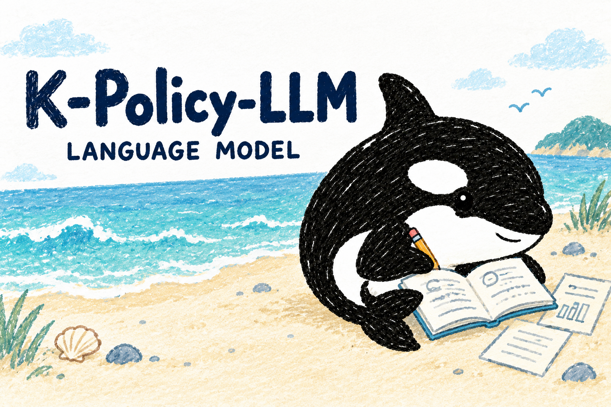</a>
<h3>14. K-Policy-LLM</h3>

<strong>기&#8288;간</strong> 2026.04 - 2026.06 / 수&#8288;업&nbsp;과&#8288;제

한&#8288;국&#8288;어 정&#8288;치&#8288;와 정&#8288;책 및 법&#8288;률 자&#8288;료&#8288;를 다&#8288;루&#8288;는 언&#8288;어&#8288;모&#8288;델&#8288;을 수&#8288;업 과&#8288;제&#8288;로 직&#8288;접 구&#8288;성&#8288;하&#8288;고 학&#8288;습&#8288;했&#8288;습&#8288;니&#8288;다. 한&#8288;국&#8288;어 중&#8288;심 80K 토&#8288;크&#8288;나&#8288;이&#8288;저&#8288;와 약 1.221B 파&#8288;라&#8288;미&#8288;터&#8288;의 Llama 계&#8288;열 모&#8288;델 구&#8288;조&#8288;를 구&#8288;성&#8288;하&#8288;고 자&#8288;료&#8288;의 토&#8288;큰&#8288;화&#8288;와 데&#8288;이&#8288;터 패&#8288;킹&#8288;을 구&#8288;현&#8288;했&#8288;습&#8288;니&#8288;다.

사&#8288;전&#8288;학&#8288;습 체&#8288;크&#8288;포&#8288;인&#8288;트&#8288;를 같&#8288;은 평&#8288;가 기&#8288;준&#8288;으&#8288;로 비&#8288;교&#8288;해 15B 토&#8288;큰 학&#8288;습 시&#8288;점&#8288;을 선&#8288;택&#8288;했&#8288;습&#8288;니&#8288;다. 이&#8288;후 CPT&#8288;로 도&#8288;메&#8288;인 지&#8288;식&#8288;을 보&#8288;완&#8288;하&#8288;고 SFT&#8288;로 지&#8288;시&#8288;문 응&#8288;답&#8288;을 학&#8288;습&#8288;한 뒤 DPO&#8288;로 응&#8288;답 선&#8288;호&#8288;를 반&#8288;영&#8288;했&#8288;습&#8288;니&#8288;다.

<h4>주&#8288;요&nbsp;결&#8288;과</h4>
<ul><li><strong>모&#8288;델 구&#8288;성&#8288;부&#8288;터 단&#8288;계&#8288;별 학&#8288;습&#8288;까&#8288;지&nbsp;수&#8288;행</strong> 데&#8288;이&#8288;터&#8288;와 토&#8288;크&#8288;나&#8288;이&#8288;저 및 모&#8288;델 구&#8288;조&#8288;를 직&#8288;접 구&#8288;성&#8288;하&#8288;고 사&#8288;전&#8288;학&#8288;습&#8288;과 후&#8288;속 학&#8288;습&#8288;을 진&#8288;행&#8288;했&#8288;습&#8288;니&#8288;다.</li><li><strong>공&#8288;개 벤&#8288;치&#8288;마&#8288;크&#8288;와 자&#8288;체 진&#8288;단&#8288;으&#8288;로 변&#8288;화&nbsp;비&#8288;교</strong> 공&#8288;개 한&#8288;국&#8288;어 벤&#8288;치&#8288;마&#8288;크&#8288;와 자&#8288;체 진&#8288;단 803&#8288;문&#8288;항&#8288;으&#8288;로 단&#8288;계&#8288;별 변&#8288;화&#8288;를 비&#8288;교&#8288;했&#8288;습&#8288;니&#8288;다. 학&#8288;습&#8288;과 평&#8288;가&#8288;를 수&#8288;행&#8288;한 수&#8288;업 과&#8288;제&#8288;이&#8288;며 서&#8288;비&#8288;스&#8288;에 배&#8288;포&#8288;한 모&#8288;델&#8288;은 아&#8288;닙&#8288;니&#8288;다.</li></ul>

<strong>사&#8288;용&nbsp;기&#8288;술</strong>  

<a href="#architecture-14">아&#8288;키&#8288;텍&#8288;처 보&#8288;기 ↓</a>

</td></tr>
</table>

<table align="left" width="400">
<tr><td width="400" valign="top">

<a href="./assets/aws-class-architecture.png">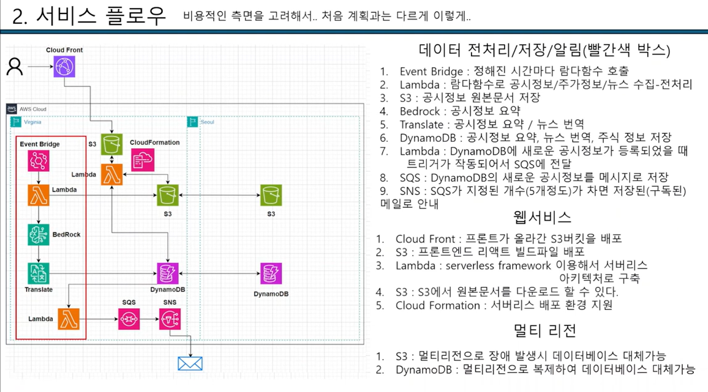</a>
<h3>15. AWS 기&#8288;반 미&#8288;국 공&#8288;시 및 뉴&#8288;스 요&#8288;약&nbsp;서&#8288;비&#8288;스</h3>

<strong>기&#8288;간</strong> 2024.12 / 클&#8288;라&#8288;우&#8288;드&#8288;컴&#8288;퓨&#8288;팅 수&#8288;업 개&#8288;인 프&#8288;로&#8288;젝&#8288;트

미&#8288;국 기&#8288;업&#8288;의 공&#8288;시&#8288;와 뉴&#8288;스&#8288;를 한&#8288;국&#8288;어&#8288;로 확&#8288;인&#8288;하&#8288;는 서&#8288;비&#8288;스&#8288;를 개&#8288;인 프&#8288;로&#8288;젝&#8288;트&#8288;로 개&#8288;발&#8288;했&#8288;습&#8288;니&#8288;다. 새 공&#8288;시&#8288;를 정&#8288;해&#8288;진 시&#8288;간&#8288;에 수&#8288;집&#8288;하&#8288;는 작&#8288;업&#8288;이&#8288;어&#8288;서 상&#8288;시 서&#8288;버&#8288;를 운&#8288;영&#8288;하&#8288;기&#8288;보&#8288;다 EventBridge&#8288;와 Lambda&#8288;로 예&#8288;약 실&#8288;행&#8288;하&#8288;는 서&#8288;버&#8288;리&#8288;스 구&#8288;성&#8288;을 선&#8288;택&#8288;했&#8288;습&#8288;니&#8288;다.

원&#8288;문&#8288;과 한&#8288;국&#8288;어 요&#8288;약&#8288;을 함&#8288;께 확&#8288;인&#8288;할 수 있&#8288;도&#8288;록 S3&#8288;에 원&#8288;문&#8288;을, DynamoDB&#8288;에 처&#8288;리 결&#8288;과&#8288;를 저&#8288;장&#8288;했&#8288;습&#8288;니&#8288;다. Bedrock 요&#8288;약&#8288;과 Translate 번&#8288;역&#8288;을 연&#8288;결&#8288;하&#8288;고, 새 공&#8288;시&#8288;는 SQS&#8288;와 SNS&#8288;로 알&#8288;려 웹 조&#8288;회&#8288;와 알&#8288;림 처&#8288;리&#8288;를 나&#8288;눴&#8288;습&#8288;니&#8288;다.

<h4>주&#8288;요&nbsp;결&#8288;과</h4>
<ul><li><strong>자&#8288;료 수&#8288;집&#8288;부&#8288;터 한&#8288;국&#8288;어 요&#8288;약&#8288;까&#8288;지&nbsp;자&#8288;동&#8288;화</strong> EventBridge&#8288;와 Lambda&#8288;로 자&#8288;료&#8288;를 주&#8288;기&#8288;적&#8288;으&#8288;로 수&#8288;집&#8288;하&#8288;고, Bedrock&#8288;의 요&#8288;약&#8288;과 Translate&#8288;의 번&#8288;역 기&#8288;능&#8288;을 연&#8288;결&#8288;했&#8288;습&#8288;니&#8288;다.</li><li><strong>수&#8288;집 결&#8288;과 저&#8288;장&#8288;과 알&#8288;림 처&#8288;리&nbsp;구&#8288;현</strong> 처&#8288;리 결&#8288;과&#8288;를 S3&#8288;와 DynamoDB&#8288;에 저&#8288;장&#8288;하&#8288;고 SQS&#8288;와 SNS&#8288;를 활&#8288;용&#8288;해 새 공&#8288;시 알&#8288;림&#8288;을 처&#8288;리&#8288;하&#8288;도&#8288;록 구&#8288;성&#8288;했&#8288;습&#8288;니&#8288;다.</li></ul>

<strong>사&#8288;용&nbsp;기&#8288;술</strong>  

<a href="#architecture-15">아&#8288;키&#8288;텍&#8288;처 보&#8288;기 ↓</a>

<a href="./assets/aws-class-architecture.png">아&#8288;키&#8288;텍&#8288;처 크&#8288;게 보&#8288;기 ↗</a> / <a href="https://youtu.be/vj_fyFRyBtQ">프&#8288;로&#8288;젝&#8288;트 시&#8288;연 영&#8288;상 ↗</a>

</td></tr>
</table>

 

<table align="left" width="400">
<tr><td width="400" valign="top">

<h3>16. 조&#8288;건&#8288;별 장&#8288;소 검&#8288;색 웹&#8288;서&#8288;비&#8288;스</h3>

<strong>기&#8288;간</strong> 2024&#8288;년 1&#8288;학&#8288;기 / 데&#8288;이&#8288;터&#8288;베&#8288;이&#8288;스 수&#8288;업&nbsp;과&#8288;제

인&#8288;원&#8288;과 위&#8288;치, 예&#8288;산, 이&#8288;용 시&#8288;간&#8288;에 맞&#8288;는 장&#8288;소&#8288;를 찾&#8288;는 웹&#8288;서&#8288;비&#8288;스&#8288;를 팀&#8288;으&#8288;로 개&#8288;발&#8288;했&#8288;습&#8288;니&#8288;다. 목&#8288;록&#8288;을 하&#8288;나&#8288;씩 확&#8288;인&#8288;하&#8288;는 대&#8288;신 여&#8288;러 조&#8288;건&#8288;으&#8288;로 후&#8288;보&#8288;를 좁&#8288;힐 수 있&#8288;도&#8288;록 Next.js 화&#8288;면&#8288;의 검&#8288;색 조&#8288;건&#8288;을 nestJS API&#8288;에 전&#8288;달&#8288;하&#8288;고, TypeORM&#8288;에&#8288;서 입&#8288;력&#8288;된 조&#8288;건&#8288;에 맞&#8288;춰 MySQL 조&#8288;회 조&#8288;건&#8288;을 조&#8288;합&#8288;했&#8288;습&#8288;니&#8288;다.

장&#8288;소 정&#8288;보&#8288;에 회&#8288;원&#8288;의 평&#8288;가&#8288;를 연&#8288;결&#8288;하&#8288;려&#8288;고 장&#8288;소&#8288;와 회&#8288;원, 평&#8288;가&#8288;를 관&#8288;계&#8288;형 데&#8288;이&#8288;터&#8288;로 구&#8288;성&#8288;했&#8288;습&#8288;니&#8288;다. 검&#8288;색 결&#8288;과&#8288;에&#8288;서 장&#8288;소 상&#8288;세&#8288;와 평&#8288;가&#8288;를 이&#8288;어 볼 수 있&#8288;도&#8288;록 화&#8288;면&#8288;과 API&#8288;를 연&#8288;결&#8288;하&#8288;고 입&#8288;력 조&#8288;건&#8288;을 실&#8288;제 DB 조&#8288;회&#8288;로 옮&#8288;기&#8288;는 과&#8288;정&#8288;을 구&#8288;현&#8288;했&#8288;습&#8288;니&#8288;다.

<h4>주&#8288;요&nbsp;결&#8288;과</h4>
<ul><li><strong>조&#8288;건&#8288;별 장&#8288;소 탐&#8288;색 기&#8288;능&nbsp;구&#8288;현</strong> Next.js&#8288;와 nestJS&#8288;로 검&#8288;색 화&#8288;면&#8288;과 API&#8288;를 구&#8288;성&#8288;해 사&#8288;용&#8288;자&#8288;가 입&#8288;력&#8288;한 조&#8288;건&#8288;에 맞&#8288;는 장&#8288;소 정&#8288;보&#8288;를 제&#8288;공&#8288;했&#8288;습&#8288;니&#8288;다.</li><li><strong>서&#8288;비&#8288;스 데&#8288;이&#8288;터 구&#8288;조 설&#8288;계 및&nbsp;연&#8288;동</strong> MySQL&#8288;과 TypeORM&#8288;으&#8288;로 장&#8288;소, 회&#8288;원, 게&#8288;시&#8288;글, 평&#8288;가 데&#8288;이&#8288;터&#8288;를 관&#8288;리&#8288;하&#8288;고 조&#8288;회 기&#8288;능&#8288;에 연&#8288;결&#8288;했&#8288;습&#8288;니&#8288;다.</li></ul>

<strong>사&#8288;용&nbsp;기&#8288;술</strong>    

<a href="#architecture-16">아&#8288;키&#8288;텍&#8288;처 보&#8288;기 ↓</a>

<a href="https://github.com/highcastle01/path_recom_db_pj">공&#8288;개 저&#8288;장&#8288;소 ↗</a>

</td></tr>
</table>

<table align="left" width="400">
<tr><td width="400" valign="top">

<h3>17. 웹&#8288;서&#8288;비&#8288;스&#8288;설&#8288;계&nbsp;과&#8288;제</h3>

<strong>기&#8288;간</strong> 2024.11 - 2024.12 / 수&#8288;업&nbsp;과&#8288;제

웹&#8288;서&#8288;비&#8288;스&#8288;설&#8288;계 수&#8288;업&#8288;에&#8288;서 영&#8288;화 탐&#8288;색 화&#8288;면&#8288;과 로&#8288;그&#8288;인, 별&#8288;도&#8288;의 채&#8288;용 정&#8288;보 API&#8288;를 과&#8288;제&#8288;별&#8288;로 개&#8288;발&#8288;했&#8288;습&#8288;니&#8288;다. 영&#8288;화 화&#8288;면&#8288;은 TMDB&#8288;의 목&#8288;록&#8288;과 상&#8288;세 정&#8288;보&#8288;를 React&#8288;에 연&#8288;결&#8288;하&#8288;고, 후&#8288;속 과&#8288;제&#8288;에&#8288;서&#8288;는 카&#8288;카&#8288;오 로&#8288;그&#8288;인&#8288;과 사&#8288;용&#8288;자 정&#8288;보 처&#8288;리&#8288;를 추&#8288;가&#8288;했&#8288;습&#8288;니&#8288;다.

백&#8288;엔&#8288;드 과&#8288;제&#8288;에&#8288;서&#8288;는 채&#8288;용 공&#8288;고&#8288;와 기&#8288;업 정&#8288;보, 지&#8288;원&#8288;과 리&#8288;뷰&#8288;를 Express&#8288;와 MySQL&#8288;로 관&#8288;리&#8288;했&#8288;습&#8288;니&#8288;다. 요&#8288;청 조&#8288;건&#8288;과 응&#8288;답 형&#8288;식&#8288;을 확&#8288;인&#8288;할 수 있&#8288;도&#8288;록 Swagger 문&#8288;서&#8288;를 작&#8288;성&#8288;했&#8288;고, 프&#8288;론&#8288;트&#8288;엔&#8288;드&#8288;는 GitHub Actions&#8288;의 검&#8288;사&#8288;와 빌&#8288;드&#8288;를 거&#8288;쳐 Pages&#8288;에 배&#8288;포&#8288;하&#8288;도&#8288;록 연&#8288;결&#8288;했&#8288;습&#8288;니&#8288;다.

<h4>주&#8288;요&nbsp;결&#8288;과</h4>
<ul><li><strong>영&#8288;화 탐&#8288;색 화&#8288;면&#8288;과 로&#8288;그&#8288;인 기&#8288;능&nbsp;구&#8288;현</strong> React&#8288;와 TypeScript&#8288;로 영&#8288;화 탐&#8288;색 화&#8288;면&#8288;을 만&#8288;들&#8288;고, 후&#8288;속 과&#8288;제&#8288;에&#8288;서 카&#8288;카&#8288;오 로&#8288;그&#8288;인&#8288;을 구&#8288;현&#8288;했&#8288;습&#8288;니&#8288;다.</li><li><strong>API 개&#8288;발&#8288;과&nbsp;문&#8288;서&#8288;화</strong> 별&#8288;도 API 과&#8288;제&#8288;에&#8288;서 Express&#8288;와 MySQL&#8288;을 활&#8288;용&#8288;해 서&#8288;버&#8288;를 개&#8288;발&#8288;하&#8288;고 Swagger&#8288;로 API 문&#8288;서&#8288;를 작&#8288;성&#8288;했&#8288;습&#8288;니&#8288;다.</li><li><strong>프&#8288;론&#8288;트&#8288;엔&#8288;드 배&#8288;포&nbsp;자&#8288;동&#8288;화</strong> GitHub Actions&#8288;로 검&#8288;사&#8288;와 빌&#8288;드&#8288;를 거&#8288;쳐 프&#8288;론&#8288;트&#8288;엔&#8288;드&#8288;를 Pages&#8288;에 자&#8288;동 배&#8288;포&#8288;하&#8288;도&#8288;록&nbsp;구&#8288;성</li></ul>

<strong>사&#8288;용&nbsp;기&#8288;술</strong>     

<a href="#architecture-17">아&#8288;키&#8288;텍&#8288;처 보&#8288;기 ↓</a>

<a href="https://github.com/highcastle01/wsd-assignment-02">영&#8288;화 탐&#8288;색 화&#8288;면 ↗</a> / <a href="https://github.com/highcastle01/WSD-Assignment-03">API 과&#8288;제 ↗</a> / <a href="https://github.com/highcastle01/WSD-Assignment-04">카&#8288;카&#8288;오 로&#8288;그&#8288;인 ↗</a>

</td></tr>
</table>

 

<table align="left" width="400">
<tr><td width="400" valign="top">

<h3>18. Java 게&#8288;임&nbsp;개&#8288;발</h3>

<strong>기&#8288;간</strong> 2023&#8288;년 1&#8288;학&#8288;기 / 객&#8288;체&#8288;지&#8288;향&#8288;프&#8288;로&#8288;그&#8288;래&#8288;밍 수&#8288;업&nbsp;과&#8288;제

객&#8288;체&#8288;지&#8288;향&#8288;프&#8288;로&#8288;그&#8288;래&#8288;밍 수&#8288;업 과&#8288;제&#8288;로 Java&#8288;를 사&#8288;용&#8288;해 게&#8288;임&#8288;을 구&#8288;현&#8288;했&#8288;습&#8288;니&#8288;다.

<strong>사&#8288;용&nbsp;기&#8288;술</strong> 

<a href="https://youtu.be/GCLQlJdoXWk">게&#8288;임 시&#8288;연 영&#8288;상 ↗</a>

</td></tr>
</table>

<table align="left" width="400">
<tr><td width="400" valign="top">

<a href="https://coala.jbnu.ac.kr/">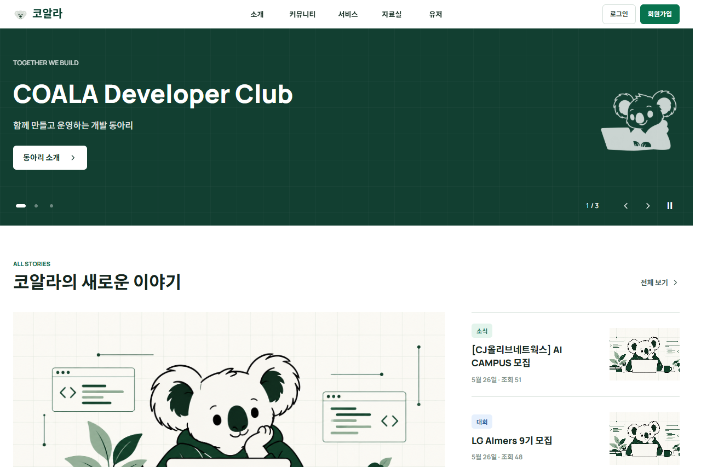</a>
<h3>19. COALA 홈&#8288;페&#8288;이&#8288;지</h3>

<strong>활&#8288;동&nbsp;기&#8288;간</strong> 2024.03 - 2025.08 / 동&#8288;아&#8288;리 회&#8288;장, 웹&#8288;사&#8288;이&#8288;트&nbsp;개&#8288;발

개&#8288;발 동&#8288;아&#8288;리 COALA&#8288;의 공&#8288;지&#8288;와 자&#8288;료&#8288;를 찾&#8288;고 모&#8288;집&#8288;과 활&#8288;동&#8288;에 참&#8288;여&#8288;할 수 있&#8288;는 홈&#8288;페&#8288;이&#8288;지 개&#8288;발&#8288;에 참&#8288;여&#8288;했&#8288;습&#8288;니&#8288;다. 자&#8288;주 찾&#8288;는 정&#8288;보&#8288;를 먼&#8288;저 볼 수 있&#8288;도&#8288;록 메&#8288;인 화&#8288;면&#8288;의 공&#8288;지&#8288;와 자&#8288;료, 게&#8288;시&#8288;글 배&#8288;치&#8288;를 조&#8288;정&#8288;했&#8288;습&#8288;니&#8288;다.

화&#8288;면&#8288;에&#8288;서&#8288;는 정&#8288;보&#8288;를 탐&#8288;색&#8288;하&#8288;고 참&#8288;여&#8288;를 요&#8288;청&#8288;하&#8288;며, Spring Boot API&#8288;에&#8288;서&#8288;는 회&#8288;원 권&#8288;한&#8288;을 확&#8288;인&#8288;하&#8288;고 데&#8288;이&#8288;터&#8288;를 처&#8288;리&#8288;하&#8288;도&#8288;록 역&#8288;할&#8288;을 나&#8288;눴&#8288;습&#8288;니&#8288;다. 회&#8288;원&#8288;과 활&#8288;동 기&#8288;록&#8288;은 PostgreSQL&#8288;에, 이&#8288;메&#8288;일 인&#8288;증 코&#8288;드&#8288;와 토&#8288;큰 상&#8288;태&#8288;는 Redis&#8288;에 두&#8288;는 구&#8288;조&#8288;로 구&#8288;성&#8288;했&#8288;습&#8288;니&#8288;다. 회&#8288;장&#8288;으&#8288;로 스&#8288;터&#8288;디&#8288;와 멘&#8288;토&#8288;링&#8288;을 운&#8288;영&#8288;하&#8288;며 홈&#8288;페&#8288;이&#8288;지 개&#8288;발&#8288;도 함&#8288;께 진&#8288;행&#8288;했&#8288;습&#8288;니&#8288;다.

<h4>주&#8288;요&nbsp;결&#8288;과</h4>
<ul><li><strong>동&#8288;아&#8288;리 홈&#8288;페&#8288;이&#8288;지 개&#8288;발&#8288;과 메&#8288;인 화&#8288;면 구&#8288;성&nbsp;조&#8288;정</strong> 게&#8288;시&#8288;판&#8288;과 모&#8288;집, 활&#8288;동 관&#8288;리 기&#8288;능&#8288;을 개&#8288;발&#8288;하&#8288;고 공&#8288;지&#8288;와 자&#8288;료&#8288;에 우&#8288;선 접&#8288;근&#8288;하&#8288;도&#8288;록 화&#8288;면&#8288;을 구&#8288;성&#8288;했&#8288;습&#8288;니&#8288;다.</li><li><strong>개&#8288;발 동&#8288;아&#8288;리 회&#8288;장&nbsp;활&#8288;동</strong> 스&#8288;터&#8288;디&#8288;와 멘&#8288;토&#8288;링&#8288;을 진&#8288;행&#8288;하&#8288;며 동&#8288;아&#8288;리 학&#8288;습 활&#8288;동&#8288;을 운&#8288;영&#8288;했&#8288;습&#8288;니&#8288;다.</li></ul>

<strong>사&#8288;용&nbsp;기&#8288;술</strong>     

<a href="#architecture-19">아&#8288;키&#8288;텍&#8288;처 보&#8288;기 ↓</a>

<a href="https://coala.jbnu.ac.kr/">coala.jbnu.ac.kr ↗</a> <a href="https://github.com/JBNU-COALA/coala-web-fe">Frontend</a> / <a href="https://github.com/JBNU-COALA/coala-web-be-main">Backend</a> / <a href="https://github.com/JBNU-COALA">GitHub 조&#8288;직</a>

</td></tr>
</table>

 

<table align="left" width="400">
<tr><td width="400" valign="top">

<a href="https://jbig.co.kr/">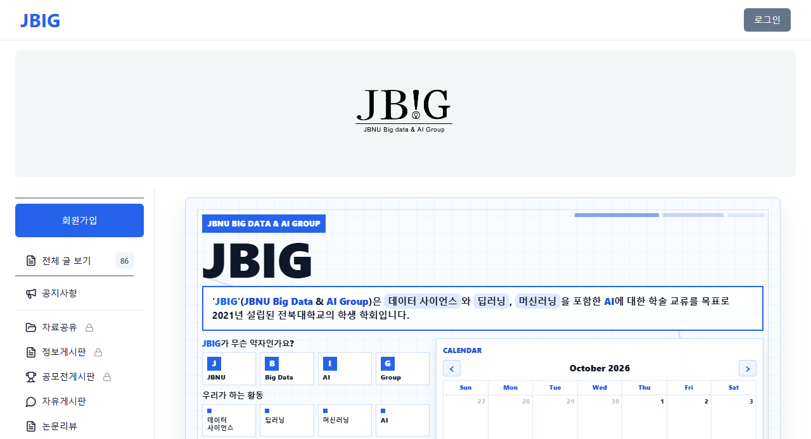</a>
<h3>20. JBIG 홈&#8288;페&#8288;이&#8288;지</h3>

<strong>활&#8288;동&nbsp;기&#8288;간</strong> 2023.03 - 2024.08 / 동&#8288;아&#8288;리 임&#8288;원 및 부&#8288;원, 웹&#8288;사&#8288;이&#8288;트 개&#8288;발&nbsp;참&#8288;여

AI 동&#8288;아&#8288;리 JBIG&#8288;의 자&#8288;료 공&#8288;유&#8288;와 스&#8288;터&#8288;디 및 프&#8288;로&#8288;젝&#8288;트 모&#8288;집&#8288;을 위&#8288;한 홈&#8288;페&#8288;이&#8288;지 개&#8288;발&#8288;에 참&#8288;여&#8288;했&#8288;습&#8288;니&#8288;다. 회&#8288;원&#8288;이 글&#8288;을 쓰&#8288;고 모&#8288;집&#8288;에 참&#8288;여&#8288;할 수 있&#8288;도&#8288;록 React 화&#8288;면&#8288;에 Django REST Framework&#8288;의 회&#8288;원&#8288;과 게&#8288;시&#8288;판 및 모&#8288;집 API&#8288;를 연&#8288;결&#8288;했&#8288;습&#8288;니&#8288;다.

자&#8288;료&#8288;를 읽&#8288;는 회&#8288;원&#8288;과 게&#8288;시&#8288;물&#8288;을 관&#8288;리&#8288;하&#8288;는 운&#8288;영&#8288;진&#8288;의 권&#8288;한&#8288;을 구&#8288;분&#8288;하&#8288;려&#8288;고 회&#8288;원 인&#8288;증&#8288;을 API 처&#8288;리&#8288;에 연&#8288;결&#8288;했&#8288;습&#8288;니&#8288;다. 회&#8288;원&#8288;과 게&#8288;시&#8288;글, 지&#8288;원 기&#8288;록&#8288;을 Django ORM&#8288;으&#8288;로 연&#8288;결&#8288;해 누&#8288;가 글&#8288;을 쓰&#8288;고 모&#8288;집&#8288;에 지&#8288;원&#8288;했&#8288;는&#8288;지 관&#8288;리&#8288;하&#8288;도&#8288;록 구&#8288;성&#8288;했&#8288;습&#8288;니&#8288;다.

<h4>주&#8288;요&nbsp;결&#8288;과</h4>
<ul><li><strong>동&#8288;아&#8288;리 커&#8288;뮤&#8288;니&#8288;티 기&#8288;능&nbsp;개&#8288;발</strong> React&#8288;와 Django 기&#8288;반 웹&#8288;사&#8288;이&#8288;트&#8288;에&#8288;서 게&#8288;시&#8288;판&#8288;과 댓&#8288;글, 공&#8288;지, 스&#8288;터&#8288;디 및 프&#8288;로&#8288;젝&#8288;트 모&#8288;집 기&#8288;능&#8288;을 개&#8288;발&#8288;했&#8288;습&#8288;니&#8288;다.</li><li><strong>회&#8288;원 인&#8288;증&#8288;과 운&#8288;영 기&#8288;능&nbsp;구&#8288;현</strong> 회&#8288;원 인&#8288;증&#8288;과 이&#8288;메&#8288;일 처&#8288;리, 관&#8288;리&#8288;자 기&#8288;능&#8288;을 구&#8288;성&#8288;해 회&#8288;원 활&#8288;동&#8288;과 게&#8288;시&#8288;물&#8288;을 관&#8288;리&#8288;하&#8288;도&#8288;록 구&#8288;현&#8288;했&#8288;습&#8288;니&#8288;다.</li></ul>

<strong>사&#8288;용&nbsp;기&#8288;술</strong>    

<a href="#architecture-20">아&#8288;키&#8288;텍&#8288;처 보&#8288;기 ↓</a>

<a href="https://jbig.co.kr/">jbig.co.kr ↗</a> <a href="https://github.com/dev-JBIG/jbig_frontend">Frontend</a> / <a href="https://github.com/dev-JBIG/jbig_backend">Backend</a> / <a href="https://github.com/dev-JBIG">GitHub 조&#8288;직</a>

</td></tr>
</table>

 

<strong>14. K-Policy-LLM / 아&#8288;키&#8288;텍&#8288;처</strong>

<a href="./assets/kpolicy-training-evaluation.drawio.png">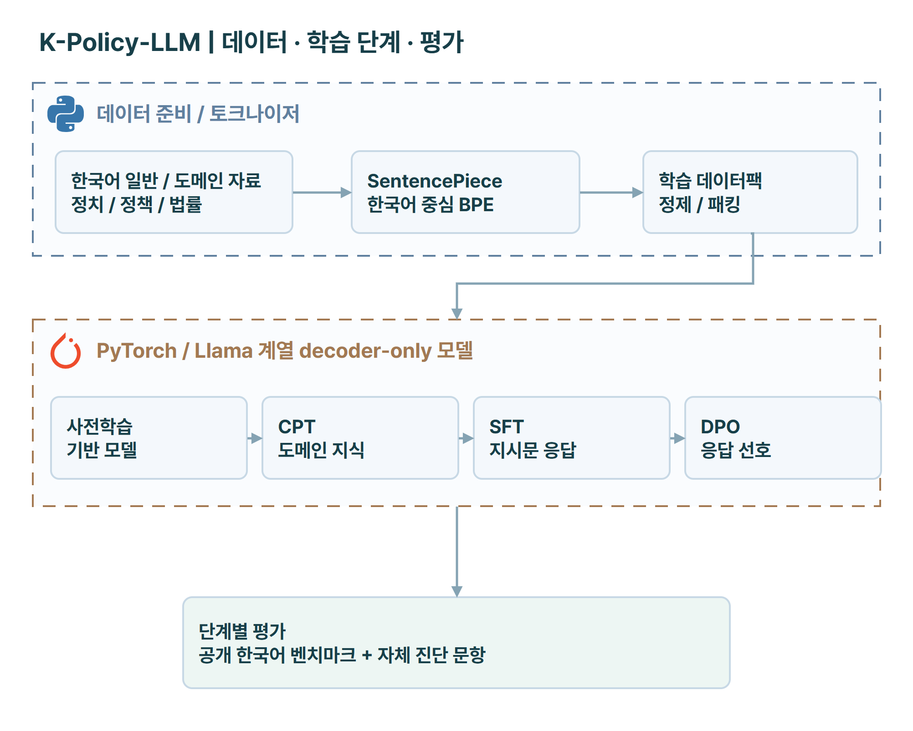</a>

<a href="./assets/kpolicy-training-evaluation.drawio.png">도&#8288;식 크&#8288;게 보&#8288;기 ↗</a> / <a href="#project-14">프&#8288;로&#8288;젝&#8288;트 설&#8288;명 ↑</a>

<strong>15. AWS 기&#8288;반 미&#8288;국 공&#8288;시 및 뉴&#8288;스 요&#8288;약 서&#8288;비&#8288;스 / 아&#8288;키&#8288;텍&#8288;처</strong>

<a href="./assets/aws-disclosure-pipeline.drawio.png">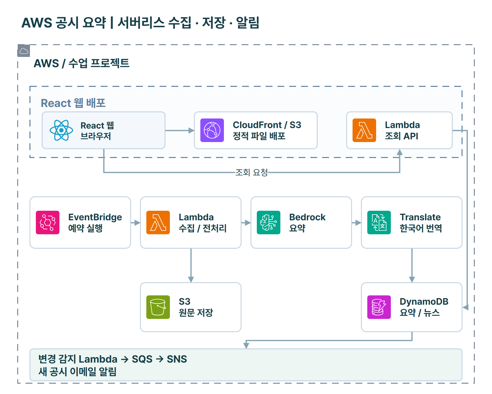</a>

<a href="./assets/aws-disclosure-pipeline.drawio.png">도&#8288;식 크&#8288;게 보&#8288;기 ↗</a> / <a href="#project-15">프&#8288;로&#8288;젝&#8288;트 설&#8288;명 ↑</a>

<strong>16. 조&#8288;건&#8288;별 장&#8288;소 검&#8288;색 웹&#8288;서&#8288;비&#8288;스 / 아&#8288;키&#8288;텍&#8288;처</strong>

<a href="./assets/places-web-database.drawio.png">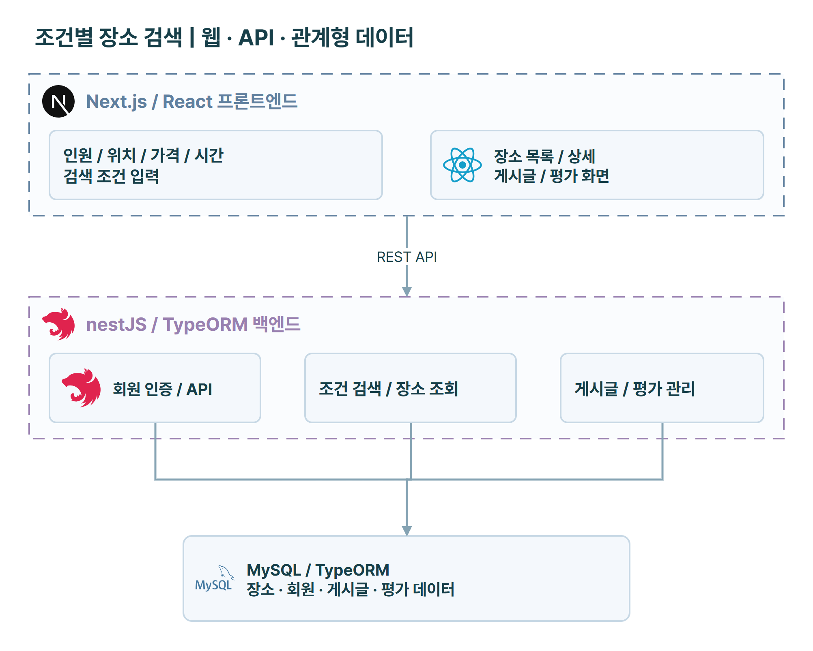</a>

<a href="./assets/places-web-database.drawio.png">도&#8288;식 크&#8288;게 보&#8288;기 ↗</a> / <a href="#project-16">프&#8288;로&#8288;젝&#8288;트 설&#8288;명 ↑</a>

<strong>17. 웹&#8288;서&#8288;비&#8288;스&#8288;설&#8288;계 과&#8288;제 / 아&#8288;키&#8288;텍&#8288;처</strong>

<a href="./assets/wsd-separate-assignments.drawio.png">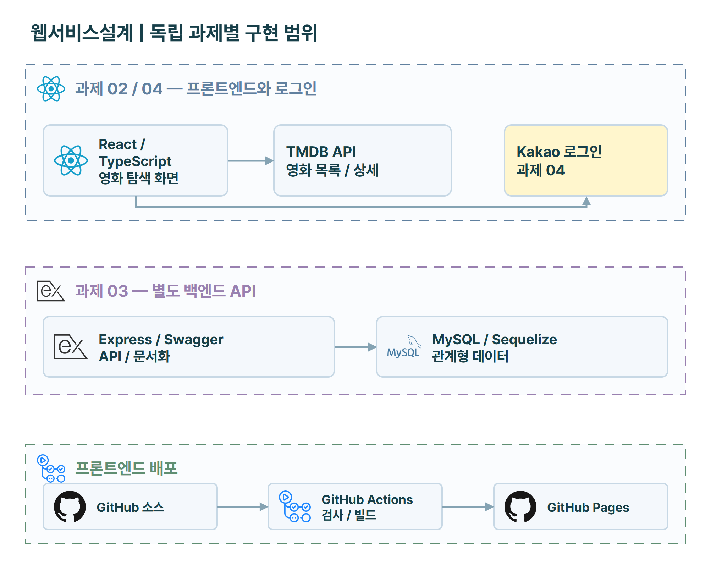</a>

<a href="./assets/wsd-separate-assignments.drawio.png">도&#8288;식 크&#8288;게 보&#8288;기 ↗</a> / <a href="#project-17">프&#8288;로&#8288;젝&#8288;트 설&#8288;명 ↑</a>

<strong>19. COALA 홈&#8288;페&#8288;이&#8288;지 / 아&#8288;키&#8288;텍&#8288;처</strong>

<a href="./assets/coala-community.drawio.png">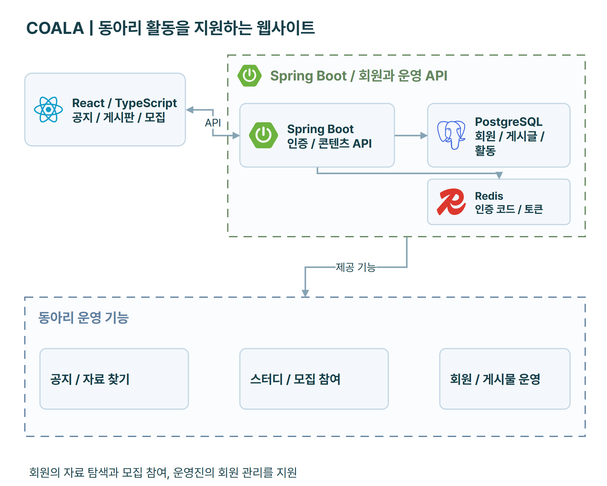</a>

<a href="./assets/coala-community.drawio.png">도&#8288;식 크&#8288;게 보&#8288;기 ↗</a> / <a href="#project-19">프&#8288;로&#8288;젝&#8288;트 설&#8288;명 ↑</a>

<strong>20. JBIG 홈&#8288;페&#8288;이&#8288;지 / 아&#8288;키&#8288;텍&#8288;처</strong>

<a href="./assets/jbig-community.drawio.png">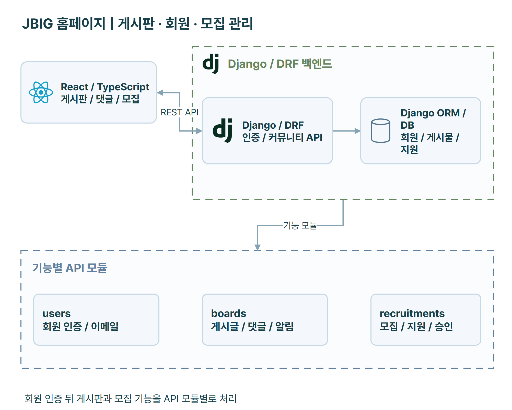</a>

<a href="./assets/jbig-community.drawio.png">도&#8288;식 크&#8288;게 보&#8288;기 ↗</a> / <a href="#project-20">프&#8288;로&#8288;젝&#8288;트 설&#8288;명 ↑</a>

<a href="#projects">프&#8288;로&#8288;젝&#8288;트 목&#8288;차 ↑</a>

## 🌊 04. Activity

<a href="https://solved.ac/profile/castleh0326">
  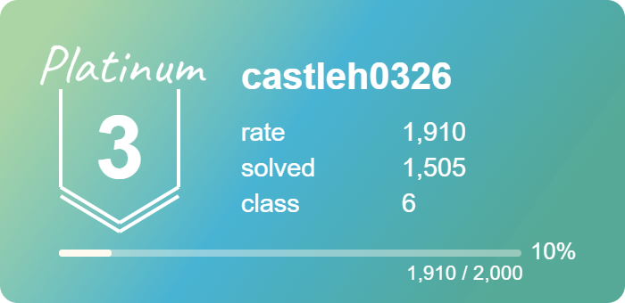
</a>

<picture>
  <source media="(prefers-color-scheme: dark)" srcset="https://github-readme-stats.vercel.app/api?username=orqan137&amp;show_icons=true&amp;hide_border=true&amp;hide_rank=true&amp;disable_animations=true&amp;theme=github_dark&amp;title_color=58a6ff&amp;icon_color=58a6ff">
  
</picture>

<table>
<tr><td>
<h3>LG Aimers 6&#8288;기</h3>

<strong>온&#8288;라&#8288;인 AI 교&#8288;육 이&#8288;수 / 온&#8288;라&#8288;인 해&#8288;커&#8288;톤&nbsp;참&#8288;여</strong>

<strong>교&#8288;육</strong> 2025.01.02–2025.01.27 <strong>온&#8288;라&#8288;인&nbsp;해&#8288;커&#8288;톤</strong> 2025.02

온&#8288;라&#8288;인 AI 교&#8288;육&#8288;을 이&#8288;수&#8288;하&#8288;고, 난&#8288;임 환&#8288;자&#8288;의 임&#8288;신 성&#8288;공 여&#8288;부&#8288;를 예&#8288;측&#8288;하&#8288;는 온&#8288;라&#8288;인 해&#8288;커&#8288;톤&#8288;에 팀&#8288;으&#8288;로 참&#8288;여&#8288;했&#8288;습&#8288;니&#8288;다. 관&#8288;련 논&#8288;문&#8288;으&#8288;로 도&#8288;메&#8288;인 지&#8288;식&#8288;을 보&#8288;완&#8288;하&#8288;며 XGBoost&#8288;와 앙&#8288;상&#8288;블 기&#8288;법&#8288;을 활&#8288;용&#8288;해 모&#8288;델 개&#8288;선&#8288;을 시&#8288;도&#8288;했&#8288;습&#8288;니&#8288;다.

<a href="https://www.lgaimers.ai/">프&#8288;로&#8288;그&#8288;램 소&#8288;개 ↗</a> / <a href="https://dacon.io/competitions/official/236452/overview/description">온&#8288;라&#8288;인 해&#8288;커&#8288;톤 ↗</a>

</td></tr>
</table>

<a href="#contents">전&#8288;체 목&#8288;차 ↑</a>

## 🐾 05. Community

<table align="left" width="400">
<tr><td width="400" valign="top">

<h3>COALA</h3>

<strong>개&#8288;발 동&#8288;아&#8288;리&nbsp;회&#8288;장</strong> 2024.03–2025.08

<h4>주&#8288;요&nbsp;활&#8288;동</h4>

스&#8288;터&#8288;디&#8288;와 멘&#8288;토&#8288;링&#8288;을 진&#8288;행&#8288;하&#8288;고 동&#8288;아&#8288;리 웹&#8288;사&#8288;이&#8288;트&#8288;를 개&#8288;발&#8288;했&#8288;습&#8288;니&#8288;다. 임&#8288;원&#8288;들&#8288;과 운&#8288;영 방&#8288;향&#8288;을 논&#8288;의&#8288;하&#8288;며 동&#8288;아&#8288;리 활&#8288;동&#8288;을 이&#8288;끌&#8288;었&#8288;습&#8288;니&#8288;다.

<a href="https://coala.jbnu.ac.kr/">홈&#8288;페&#8288;이&#8288;지 ↗</a> / <a href="https://github.com/JBNU-COALA">GitHub 조&#8288;직 ↗</a>

</td></tr>
</table>
<table align="left" width="400">
<tr><td width="400" valign="top">

<h3>JBIG</h3>

<strong>인&#8288;공&#8288;지&#8288;능 동&#8288;아&#8288;리 임&#8288;원 및&nbsp;부&#8288;원</strong> 2023.03–2024.08

<h4>주&#8288;요&nbsp;활&#8288;동</h4>

임&#8288;원&#8288;으&#8288;로 동&#8288;아&#8288;리 활&#8288;동&#8288;과 스&#8288;터&#8288;디 운&#8288;영&#8288;에 참&#8288;여&#8288;했&#8288;습&#8288;니&#8288;다. 회&#8288;원&#8288;들&#8288;이 학&#8288;습 자&#8288;료&#8288;와 활&#8288;동&#8288;을 공&#8288;유&#8288;할 수 있&#8288;도&#8288;록 커&#8288;뮤&#8288;니&#8288;티 웹&#8288;사&#8288;이&#8288;트&#8288;를 개&#8288;발&#8288;했&#8288;습&#8288;니&#8288;다.

<a href="https://jbig.co.kr/">홈&#8288;페&#8288;이&#8288;지 ↗</a> / <a href="https://github.com/dev-JBIG">GitHub 조&#8288;직 ↗</a>

</td></tr>
</table>
 

<a href="#contents">전&#8288;체 목&#8288;차 ↑</a>

## ⭐ 06. Awards

- **2025** / JBNU SW·AI 경&#8288;진&#8288;대&#8288;회 **AI 부&#8288;문 장&#8288;려&#8288;상**
- **2024** / 오&#8288;픈&#8288;소&#8288;스 SW 아&#8288;이&#8288;디&#8288;어 해&#8288;커&#8288;톤 캠&#8288;프 **팀 최&#8288;우&#8288;수&#8288;상** — 취&#8288;약&#8288;점 분&#8288;석
- **2024** / 한&#8288;국&#8288;디&#8288;지&#8288;털&#8288;콘&#8288;텐&#8288;츠&#8288;학&#8288;회 추&#8288;계&#8288;종&#8288;합&#8288;학&#8288;술&#8288;대&#8288;회 대&#8288;학&#8288;생 논&#8288;문&#8288;경&#8288;진&#8288;대&#8288;회 **은&#8288;상**
- **2024** / 2&#8288;학&#8288;기 SW&#8288;캡&#8288;스&#8288;톤&#8288;디&#8288;자&#8288;인 경&#8288;진&#8288;대&#8288;회 **장&#8288;려&#8288;상**
- **2023** / 컴&#8288;퓨&#8288;터&#8288;인&#8288;공&#8288;지&#8288;능&#8288;학&#8288;부 해&#8288;킹&#8288;대&#8288;회 **특&#8288;별&#8288;상**

