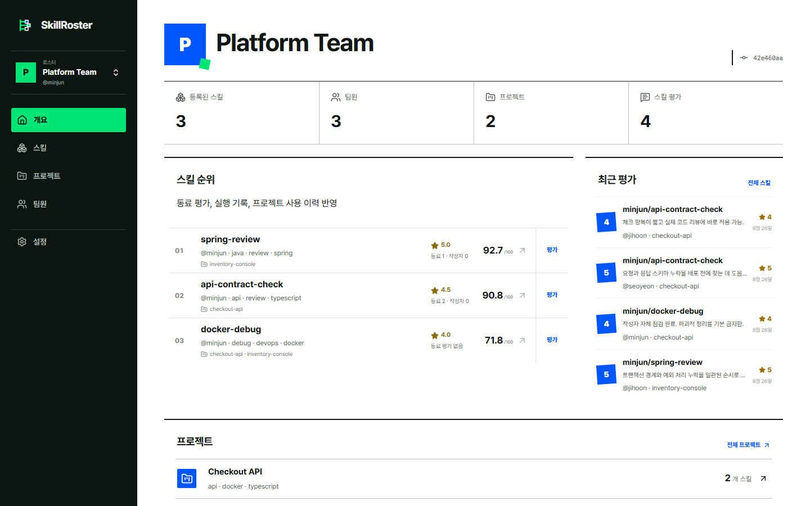
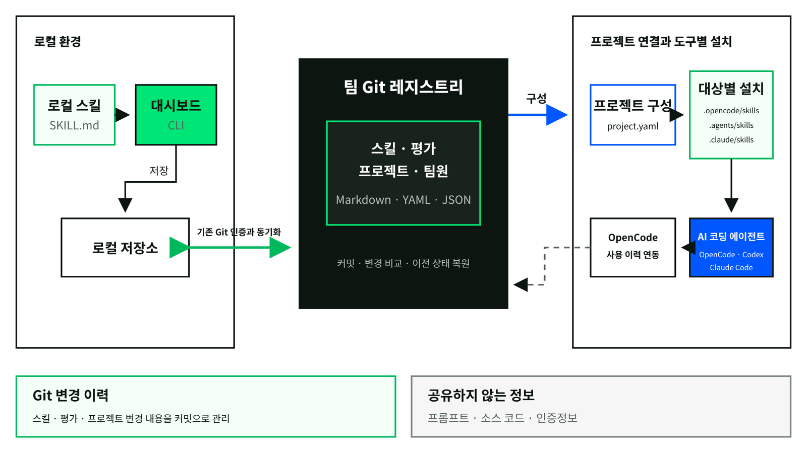

<strong>임성혁 / AI / Backend / Infrastructure</strong>

AI 서비스를 개발하고, 서비스 운영에 필요한 인프라를 구축합니다.

  
  

<strong>목차</strong> 
<a href="#experience">01. Experience</a> /
<a href="#tech-stack">02. Tech Stack</a> /
<a href="#activity">03. Activity</a> /
<a href="#projects">04. Projects</a> /
<a href="#community">05. Community</a> /
<a href="#awards">06. Awards</a>

## 🪸 01. Experience

<table>
<tr><td>

<h3>한국식품연구원</h3>

<strong>재직 기간</strong> 2025.09–현재

<strong>AI 서비스와 백엔드 개발, 온프레미스 인프라 구축 및 운영</strong>

식품데이터플랫폼과 연구자용 Agent 플랫폼을 개발하고 있습니다. 물리 서버와 컨테이너를 관리하고, 배포 자동화와 LLM 서빙, 모니터링 환경을 구축해 운영하고 있습니다.

<a href="#work-projects">업무 프로젝트 보기 ↓</a> / <a href="https://data.kfri.re.kr/">데이터플랫폼 ↗</a>

<h4>주요 결과</h4>
<ul><li><strong>RAG 문서 처리 10분 이상 → 약 4분</strong></li><li><strong>Agent 채팅 초기 처리 4.2초 → 0.14초</strong> (동일 실행환경 기준)</li><li><strong>주문배송 운송장 매칭 화면 32.176초 → 1.862초</strong></li><li><strong>기존 컨테이너 서비스 전체 이관</strong> / Kubernetes 클러스터로 통합</li></ul>
</td></tr>
</table>

<a href="#contents">전체 목차 ↑</a>

## 🫧 02. Tech Stack

<table>
<tr><td><strong>Languages</strong></td><td>    </td></tr>
<tr><td><strong>Backend</strong></td><td>      </td></tr>
<tr><td><strong>Web &amp; Mobile</strong></td><td>    </td></tr>
<tr><td><strong>Data &amp; Search</strong></td><td>    </td></tr>
<tr><td><strong>AI &amp; LLM</strong></td><td>      </td></tr>
<tr><td><strong>Infrastructure</strong></td><td>       </td></tr>
<tr><td><strong>CI/CD &amp; Monitoring</strong></td><td>    </td></tr>
</table>

<a href="#contents">전체 목차 ↑</a>

## 🌊 03. Activity

<picture>
  <source media="(prefers-color-scheme: dark)" srcset="https://github-readme-stats.vercel.app/api?username=orqan137&amp;show_icons=true&amp;hide_border=true&amp;hide_rank=true&amp;disable_animations=true&amp;theme=github_dark&amp;title_color=58a6ff&amp;icon_color=58a6ff">
  
</picture>

<table>
<tr><td>
<h3>LG Aimers 6기</h3>

<strong>온라인 AI 교육 이수 / 온라인 해커톤 참여</strong>

<strong>교육</strong> 2025.01.02–2025.01.27 <strong>온라인 해커톤</strong> 2025.02

온라인 AI 교육을 이수하고, 난임 환자의 임신 성공 여부를 예측하는 온라인 해커톤에 팀으로 참여했습니다. 관련 논문으로 도메인 지식을 보완하며 XGBoost와 앙상블 기법을 활용해 모델 개선을 시도했습니다.

<a href="https://www.lgaimers.ai/">프로그램 소개 ↗</a> / <a href="https://dacon.io/competitions/official/236452/overview/description">온라인 해커톤 ↗</a>

</td></tr>
</table>

<a href="#contents">전체 목차 ↑</a>

## 🐚 04. Projects

<strong>프로젝트 분류</strong> 
<a href="#work-projects">4.1 Work Projects</a> 
<a href="#apps-open-source">4.2 Apps &amp; Open Source</a> 
<a href="#ai-challenges">4.3 AI Challenges</a> 
<a href="#school-projects">4.4 School Projects</a> 
<a href="#community-websites">4.5 Community Websites</a>

### 4.1 Work Projects

<a href="#project-01">01. 식품데이터플랫폼</a> 
<a href="#project-02">02. COPAI / 연구자용 Agent 플랫폼</a> 
<a href="#project-03">03. 제주TP 연계 주문배송 관리</a> 
<a href="#project-04">04. Kubernetes 클러스터 구축 및 서비스 이관</a> 
<a href="#project-05">05. Ceph 분산 스토리지 구축 및 데이터 이관</a> 
<a href="#project-06">06. vLLM 기반 LLM 추론 서비스</a>

<table align="left" width="400">
<tr><td width="400" valign="top">

<h3 id="project-01">01. 식품데이터플랫폼</h3>

<strong>기간</strong> 2025.09–현재

<strong>작성 화면 개선과 문서 초안 작성 기능 개발</strong>

데이터관리계획 작성 화면을 탭으로 나눠 반복적인 스크롤을 줄였습니다. 서비스 API를 개발하고, 로컬 LLM 기반 RAG로 문서 초안을 작성하는 기능을 추가했습니다.

<h4>주요 결과</h4>
<ul><li><strong>문서 처리 10분 이상 → 약 4분</strong> LLM 호출을 줄이면서 결과 품질은 유지했습니다.</li></ul>

<strong>사용 기술</strong>     

<a href="https://data.kfri.re.kr/">공개 웹사이트 ↗</a> 업무 프로젝트 / 코드 비공개

</td></tr>
</table>
<table align="left" width="400">
<tr><td width="400" valign="top">

<h3 id="project-02">02. COPAI / 연구자용 Agent 플랫폼</h3>

<strong>기간</strong> 2025.09–현재

<strong>연구자별 AI 작업환경과 도구 공유 기능 개발</strong>

연구자별 독립 작업환경을 제공하고, 설정과 Skills, 도구를 공유하도록 설계하고 개발했습니다. 기관 계정 로그인과 모델 호출, 사용량 조회 기능을 구현했습니다.

<h4>주요 결과</h4>
<ul><li><strong>채팅 초기 처리 시간 4.2초 → 0.14초</strong> 채팅할 때마다 수행하던 저장소 전체 검사를 최근 검사 결과 조회로 바꿨습니다. 파일 저장 시 정밀 검사는 유지했습니다. 동일 실행환경에서 측정한 결과입니다.</li></ul>

<strong>사용 기술</strong>      

기관 로그인 필요 / 코드 비공개

</td></tr>
</table>
 
<table align="left" width="400">
<tr><td width="400" valign="top">

<h3 id="project-03">03. 제주TP 연계 주문배송 관리</h3>

<strong>기간</strong> 2026.04–2026.10

<strong>주문배송 업무 서비스 개발</strong>

담당자와 업무 흐름을 확인해 주문배송 관리 기능을 개발했습니다. 개인정보를 마스킹하고 합성데이터로 기능을 검증했습니다. 제한된 자원에서 AI 기능을 활용하도록 카카오의 Kanana 모델을 배포했습니다.

<h4>주요 결과</h4>
<ul><li><strong>운송장 매칭 화면 32.176초 → 1.862초</strong> 서버의 데이터 조회 방식과 OpenSearch 검색 및 집계 방식을 개선했습니다.</li></ul>

<strong>사용 기술</strong>    

업무 프로젝트 / 코드 비공개

</td></tr>
</table>
<table align="left" width="400">
<tr><td width="400" valign="top">

<h3 id="project-04">04. Kubernetes 클러스터 구축 및 서비스 이관</h3>

<strong>수행 경력</strong> 2025.09–현재

<strong>물리 서버와 컨테이너 운영</strong>

<h4>주요 결과</h4>
<ul><li><strong>기존 컨테이너 서비스 모두 이관</strong> 개별 서버에서 컨테이너로 운영하던 서비스를 모두 Kubernetes 클러스터로 이관했습니다.</li><li>물리 서버를 Kubernetes 클러스터로 구성해 서비스 배포와 자원 관리를 통합했습니다.</li><li>GitLab Runner와 Argo CD로 빌드와 배포를 자동화하고, Prometheus와 Grafana로 운영 지표를 확인하도록 구성했습니다.</li></ul>

<strong>사용 기술</strong>          

업무 프로젝트 / 코드 비공개

</td></tr>
</table>
 
<table align="left" width="400">
<tr><td width="400" valign="top">

<h3 id="project-05">05. Ceph 분산 스토리지 구축 및 데이터 이관</h3>

<strong>수행 경력</strong> 2025.09–현재

<strong>Hadoop 기반 저장 구조를 Ceph로 전환</strong>

Hadoop 기반 저장 구조를 대체할 Ceph 분산 스토리지를 구축하고, Kubernetes의 영구 저장소로 연결했습니다.

<h4>주요 결과</h4>
<ul><li><strong>용도별 저장소 구성</strong> 공동 파일은 CephFS, 독립된 저장공간은 RBD를 사용하도록 구성했습니다. 객체 저장에는 S3 호환 RGW를 적용했습니다.</li><li><strong>서비스별 데이터 이관 및 동작 검증</strong> 서비스별로 데이터를 이관하고, 파일 조회와 DB 응답 등 실제 동작을 확인했습니다.</li></ul>

<strong>사용 기술</strong>      

업무 프로젝트 / 코드 비공개

</td></tr>
</table>
<table align="left" width="400">
<tr><td width="400" valign="top">

<h3 id="project-06">06. vLLM 기반 LLM 추론 서비스</h3>

<strong>수행 경력</strong> 2025.09–현재

<strong>Solar Open 2와 Gemma 4 31B 배포 및 운영</strong>

Solar Open 2와 Gemma 4 31B를 원내 서버에 배포하고, 서비스에서 호출할 수 있는 LLM 추론 서비스를 구축했습니다.

<h4>주요 결과</h4>
<ul><li><strong>추론 요청 병렬 처리와 모델 호출 통합</strong> vLLM으로 추론 요청을 병렬 처리하고, LiteLLM으로 모델을 호출하는 방식을 통합했습니다.</li><li><strong>모델별 사용량과 요청 지표 모니터링</strong> 토큰 사용량과 요청 지표를 Prometheus로 수집하고 Grafana에서 확인하도록 구성했습니다.</li></ul>

<strong>사용 기술</strong>      

업무 프로젝트 / 코드 비공개

</td></tr>
</table>
 

<a href="#projects">프로젝트 목차 ↑</a>

### 4.2 Apps &amp; Open Source

<a href="#project-07">07. Replant</a> 
<a href="#project-08">08. 가야디 / Gayadi</a> 
<a href="#project-09">09. SkillRoster</a>

<table align="left" width="400">
<tr><td width="400" valign="top">

<h3 id="project-07">07. <a href="https://github.com/Replant-Application">Replant ↗</a></h3>

<strong>기간</strong> 2025.09–2026.02

<strong>PM / 백엔드 개발 / 앱 출시</strong>

은둔형 외톨이의 일상 회복을 돕는 앱입니다.

<h4>주요 결과</h4>
<ul><li><strong>앱 출시 / 현대오토에버 배리어프리 앱 개발 콘테스트 본선 진출</strong></li><li>일상 미션과 인증, 감정일기, 캐릭터 성장 기능을 개발했습니다.</li><li>Gemini 장애에 대비해 로컬 Qwen을 vLLM으로 서빙하는 대체 경로를 구성했습니다.</li></ul>

<strong>사용 기술</strong>          

</td></tr>
</table>
<table align="left" width="400">
<tr><td width="400" valign="top">

<h3 id="project-08">08. <a href="https://github.com/TEAM-DOONOW">가야디 / Gayadi ↗</a></h3>

<strong>기간</strong> 2026.08–2026.10

<strong>백엔드 / AI 서비스 개발 / 앱 출시</strong>

함께 여행할 사람들의 성향에 맞는 일정을 만들고, 여행 중 상황이 바뀌면 대안을 제안하는 앱입니다.

<h4>주요 결과</h4>
<ul><li><strong>여행 일정 추천 앱 개발 및 출시</strong></li><li>추천과 일정 조정 Agent에 관광, 날씨, 혼잡도 API를 연결했습니다.</li><li>일정 변경은 사용자 승인 후에만 반영하고, 버전을 검사해 오래된 추천이 최신 일정을 덮어쓰지 않도록 했습니다.</li></ul>

<strong>사용 기술</strong>      

</td></tr>
</table>
 
<table align="left" width="400">
<tr><td width="400" valign="top">

<h3 id="project-09">09. <a href="https://github.com/orqan137/skillroster">SkillRoster ↗</a></h3>

<strong>기간</strong> 2026.08

<strong>개인 오픈소스 프로젝트</strong>

팀에서 만든 Agent Skills를 등록하고, 필요한 Skills를 찾아 설치할 수 있는 공유 도구입니다.

<h4>주요 결과</h4>
<ul><li>opencode, Codex, Claude Code에서 사용할 Skills를 공유하도록 구성했습니다.</li><li>설치할 Skill의 버전을 고정하고, Git 쓰기 작업이 실패하면 작업 전 상태로 복구하도록 했습니다.</li></ul>

<strong>아키텍처</strong>  <a href="./assets/skillroster-architecture.png">아키텍처 크게 보기 ↗</a>

<strong>사용 기술</strong>     

</td></tr>
</table>
 

<a href="#projects">프로젝트 목차 ↑</a>

### 4.3 AI Challenges

<a href="#project-10">10. SCPC 2026 AI Challenge</a> 
<a href="#project-11">11. 연금 어드바이저 / mirae_pj</a>

<table align="left" width="400">
<tr><td width="400" valign="top">

<h3 id="project-10">10. <a href="https://github.com/orqan137/scpc2026">SCPC 2026 AI Challenge ↗</a></h3>

<strong>기간</strong> 2026.07–2026.08

<strong>규칙 기반 Agent와 Android 앱 개발</strong>

입력된 기기 상태와 대화 기록을 바탕으로 행동 계획을 만드는 Python Agent와, 파일 공유 초안을 준비하는 Android 앱 SafeShare를 개발했습니다.

<h4>주요 결과</h4>
<ul><li><strong>수만 건의 변형 입력 테스트에서 예외와 출력 형식 위반 없음</strong> 입력 구조와 데이터 타입, 순서를 바꿔 Agent의 응답을 검증했습니다.</li><li><strong>확인한 공유 조건을 다음 세션에서도 재사용</strong> 공유 목적과 권한을 저장하고, 조건이 바뀐 공유 초안은 보류해 다시 확인하도록 구현했습니다.</li></ul>

<strong>사용 기술</strong>   

<a href="https://github.com/orqan137/scpc2026">공개 저장소 ↗</a> / <a href="./assets/scpc-safeshare-architecture.png">아키텍처 크게 보기 ↗</a>

</td></tr>
</table>
<table align="left" width="400">
<tr><td width="400" valign="top">

<h3 id="project-11">11. <a href="https://github.com/orqan137/mirae_pj">연금 어드바이저 / mirae_pj ↗</a></h3>

<strong>기간</strong> 2026.08–2026.09

<strong>미래에셋증권 AI Festival 연금 Agent</strong>

연금 제도, 세금과 상품에 관한 질문을 나눠 필요한 근거를 찾고, 세액공제 계산과 상품 비교는 별도 모듈에서 처리하도록 구현했습니다.

<h4>주요 결과</h4>
<ul><li>HyperCLOVA X로 답변을 생성한 뒤 수치, 상품 정보와 인용이 근거와 맞는지 검사했습니다.</li><li>검증에 실패하면 인용을 보완하고, 확인되지 않은 문장을 덜어내도록 구성했습니다.</li></ul>

<strong>사용 기술</strong>    

<a href="https://github.com/orqan137/mirae_pj">공개 저장소 ↗</a> / <a href="./assets/mirae-pension-architecture.png">아키텍처 크게 보기 ↗</a>

</td></tr>
</table>
 

<a href="#projects">프로젝트 목차 ↑</a>

### 4.4 School Projects

<a href="#project-12">12. K-Policy-LLM</a> 
<a href="#project-13">13. AWS 미국 공시 및 뉴스 요약 서비스</a> 
<a href="#project-14">14. 조건별 장소 검색 웹서비스</a> 
<a href="#project-15">15. 웹서비스설계 과제</a>

재학 중 사용한 GitHub: <a href="https://github.com/highcastle01">highcastle01 ↗</a>

<table align="left" width="400">
<tr><td width="400" valign="top">

<h3 id="project-12">12. <a href="https://github.com/orqan137/K-Policy-LLM">K-Policy-LLM ↗</a></h3>

<strong>기간</strong> 2026.04–2026.06

<strong>교내 언어모델 학습 및 평가 프로젝트</strong>

한국어 정치, 정책, 법률 문서를 다루는 약 1.2B 규모의 언어모델을 학습하고 평가했습니다.

<h4>주요 결과</h4>
<ul><li>SentencePiece로 토크나이저와 학습 데이터를 구성하고 사전학습을 진행했습니다. 이후 추가 사전학습(CPT), 지도 미세조정(SFT), 선호학습(DPO)을 수행했습니다.</li><li>공개 한국어 벤치마크와 자체 진단 문항으로 학습 단계별 결과를 비교했습니다.</li></ul>

<strong>사용 기술</strong>  

</td></tr>
</table>
<table align="left" width="400">
<tr><td width="400" valign="top">

<h3 id="project-13">13. AWS 미국 공시 및 뉴스 요약 서비스</h3>

<strong>기간</strong> 2024.12

<strong>클라우드컴퓨팅 수업 프로젝트</strong>

미국 기업의 공시와 뉴스를 한국어로 확인하기 위해 수집, 요약, 번역과 알림 기능을 구현했습니다. 비용을 고려해 정해진 시간에 데이터를 수집하도록 구성했습니다.

<h4>주요 결과</h4>
<ul><li>EventBridge와 Lambda로 데이터를 수집하고, Bedrock과 Translate로 공시 요약과 번역을 처리했습니다.</li><li>S3와 DynamoDB에 결과를 저장하고 SQS와 SNS로 새 공시를 알리도록 구성했습니다.</li></ul>

<strong>사용 기술</strong>  

<a href="./assets/aws-class-architecture.png">아키텍처 크게 보기 ↗</a> / <a href="https://youtu.be/vj_fyFRyBtQ">프로젝트 시연 영상 ↗</a>

</td></tr>
</table>
 
<table align="left" width="400">
<tr><td width="400" valign="top">
<h3 id="project-14">14. 조건별 장소 검색 웹서비스</h3>

<strong>기간</strong> 2024년 1학기

<strong>데이터베이스 수업 팀 프로젝트</strong>

음식점, 카페, 놀이시설과 술집을 인원, 위치, 가격, 시간 등의 조건으로 찾는 웹서비스를 팀으로 개발했습니다.

<h4>주요 결과</h4>
<ul><li>Next.js 프론트엔드와 nestJS 백엔드를 연결했습니다.</li><li>TypeORM과 MySQL로 장소, 회원, 게시글, 평가 데이터를 관리했습니다.</li></ul>

<strong>사용 기술</strong>    

<a href="https://github.com/highcastle01/path_recom_db_pj">공개 저장소 ↗</a>

</td></tr>
</table>
<table align="left" width="400">
<tr><td width="400" valign="top">
<h3 id="project-15">15. 웹서비스설계 과제</h3>

<strong>기간</strong> 2024.11–2024.12 / 공개 개발 기록

<strong>프론트엔드, API와 로그인 구현</strong>

<h4>주요 결과</h4>
<ul><li>React와 TypeScript로 영화 탐색 화면을 만들고, 후속 과제에서 카카오 로그인을 추가했습니다.</li><li>GitHub Actions로 GitHub Pages 배포를 자동화했습니다.</li><li>별도 API 과제에서는 Express와 MySQL을 사용하고 Swagger로 API 문서를 작성했습니다.</li></ul>

<strong>사용 기술</strong>     

<a href="https://github.com/highcastle01/wsd-assignment-02">영화 탐색 화면 ↗</a> / <a href="https://github.com/highcastle01/WSD-Assignment-03">API 과제 ↗</a> / <a href="https://github.com/highcastle01/WSD-Assignment-04">카카오 로그인 ↗</a>

</td></tr>
</table>
 

<a href="#projects">프로젝트 목차 ↑</a>

### 4.5 Community Websites

<a href="#project-16">16. COALA 홈페이지</a> 
<a href="#project-17">17. JBIG CAFE</a>

<table align="left" width="400">
<tr><td width="400" valign="top">

<h3 id="project-16">16. COALA 홈페이지</h3>

<strong>활동 기간</strong> 2024.03–2025.08

<h4>주요 결과</h4>
<ul><li>동아리의 커뮤니티와 모집, 활동 기록을 모은 웹사이트를 개발했습니다.</li><li>자료 공유와 서버 인스턴스 대여 기능도 구현했습니다.</li></ul>

<strong>사용 기술</strong>     

<a href="https://coala.jbnu.ac.kr/">coala.jbnu.ac.kr ↗</a> <a href="https://github.com/JBNU-COALA/coala-web-fe">Frontend</a> / <a href="https://github.com/JBNU-COALA/coala-web-be-main">Backend</a> / <a href="https://github.com/JBNU-COALA">GitHub 조직</a>

</td></tr>
</table>
<table align="left" width="400">
<tr><td width="400" valign="top">

<h3 id="project-17">17. JBIG CAFE</h3>

<strong>활동 기간</strong> 2023.03–2024.08

<h4>주요 결과</h4>
<ul><li>인공지능 동아리의 공지와 학습 자료, 스터디와 프로젝트 모집을 위한 커뮤니티를 개발했습니다.</li><li>게시판과 댓글, 회원 관리 기능을 구현했습니다.</li></ul>

<strong>사용 기술</strong>    

<a href="https://jbig.co.kr/">jbig.co.kr ↗</a> <a href="https://github.com/dev-JBIG/jbig_frontend">Frontend</a> / <a href="https://github.com/dev-JBIG/jbig_backend">Backend</a> / <a href="https://github.com/dev-JBIG">GitHub 조직</a>

</td></tr>
</table>
 

<a href="#contents">전체 목차 ↑</a>

## 🐾 05. Community

<table align="left" width="400">
<tr><td width="400" valign="top">

<h3>COALA</h3>

<strong>개발 동아리 회장</strong> 2024.03–2025.08

<h4>주요 활동</h4>

스터디와 멘토링을 진행하고 동아리 웹사이트를 개발했습니다. 임원들과 운영 방향을 논의하며 동아리 활동을 이끌었습니다.

<a href="https://coala.jbnu.ac.kr/">홈페이지 ↗</a> / <a href="https://github.com/JBNU-COALA">GitHub 조직 ↗</a>

</td></tr>
</table>
<table align="left" width="400">
<tr><td width="400" valign="top">

<h3>JBIG</h3>

<strong>인공지능 동아리 임원 및 회원</strong> 2023.03–2024.08

<h4>주요 활동</h4>

임원으로 동아리 활동과 스터디 운영에 참여했습니다. 회원들이 학습 자료와 활동을 공유할 수 있도록 커뮤니티 웹사이트를 개발했습니다.

<a href="https://jbig.co.kr/">홈페이지 ↗</a> / <a href="https://github.com/dev-JBIG">GitHub 조직 ↗</a>

</td></tr>
</table>
 

<a href="#contents">전체 목차 ↑</a>

## ⭐ 06. Awards

- **2025** / JBNU SW·AI 경진대회 **AI 부문 장려상**
- **2024** / 오픈소스 SW 아이디어 해커톤 캠프 **팀 최우수상** — 취약점 분석
- **2024** / 한국디지털콘텐츠학회 추계종합학술대회 대학생 논문경진대회 **은상**
- **2024** / 2학기 SW캡스톤디자인 경진대회 **장려상**
- **2023** / 컴퓨터인공지능학부 해킹대회 **특별상**
