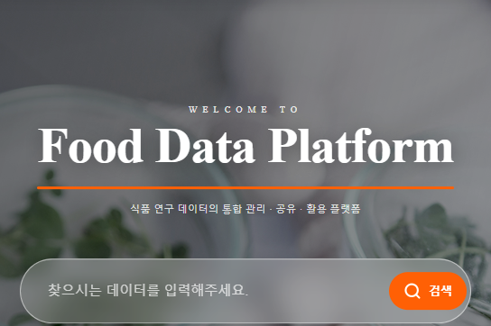

<strong>임성혁 / AI / Backend / Infrastructure</strong>

AI 서비스를 개발하고, 서비스 운영에 필요한 인프라를 구축합니다.

  
  

<strong>목차</strong> 
<a href="#experience">01. Experience</a> /
<a href="#tech-stack">02. Tech Stack</a> /
<a href="#activity">03. Activity</a> /
<a href="#projects">04. Projects</a> /
<a href="#community">05. Community</a> /
<a href="#awards">06. Awards</a>

## 🪸 01. Experience

<table>
<tr><td>

<h3>한국식품연구원</h3>

<strong>재직 기간</strong> 2025.09–현재

<strong>AI 서비스와 백엔드 개발, 온프레미스 인프라 구축 및 운영</strong>

데이터플랫폼의 작성 화면과 API를 개선한 뒤, 연구자가 자료와 지침을 다시 찾아 초안을 정리하는 작업까지 살펴보며 RAG 기능을 설계하고 연결했습니다. 이후 연구자용 Agent 플랫폼을 맡았을 때는 개별 VM 제공만으로 활용법과 도구가 흩어지는 문제를 해결하기 어렵다고 보고, 개인 작업환경과 공유 자산을 함께 관리하는 통합 플랫폼을 제안하고 직접 개발했습니다. 플랫폼을 실제로 운영하기 위해 Kubernetes와 Ceph, LLM 추론 서비스와 배포 환경도 구축하고 서비스별 동작을 확인하며 전환했습니다.

<a href="#work-projects">업무 프로젝트 보기 ↓</a> / <a href="https://data.kfri.re.kr/">데이터플랫폼 ↗</a>

<h4>주요 결과</h4>
<ul><li><strong>RAG 문서 처리 10분 이상 → 약 4분</strong></li><li><strong>Agent 채팅 초기 처리 4.2초 → 0.14초</strong></li><li><strong>주문배송 배송장 매칭 조회 32.176초 → 1.862초</strong></li><li><strong>기존 컨테이너 서비스 전체 이관</strong> / Kubernetes 클러스터로 통합</li></ul>
</td></tr>
</table>

<a href="#contents">전체 목차 ↑</a>

## 🫧 02. Tech Stack

<table>
<tr><td><strong>Languages</strong></td><td>    </td></tr>
<tr><td><strong>Backend</strong></td><td>      </td></tr>
<tr><td><strong>Web &amp; Mobile</strong></td><td>    </td></tr>
<tr><td><strong>Data &amp; Search</strong></td><td>    </td></tr>
<tr><td><strong>AI &amp; LLM</strong></td><td>      </td></tr>
<tr><td><strong>Infrastructure</strong></td><td>       </td></tr>
<tr><td><strong>CI/CD &amp; Monitoring</strong></td><td>    </td></tr>
</table>

<a href="#contents">전체 목차 ↑</a>

## 🌊 03. Activity

<picture>
  <source media="(prefers-color-scheme: dark)" srcset="https://github-readme-stats.vercel.app/api?username=orqan137&amp;show_icons=true&amp;hide_border=true&amp;hide_rank=true&amp;disable_animations=true&amp;theme=github_dark&amp;title_color=58a6ff&amp;icon_color=58a6ff">
  
</picture>

<table>
<tr><td>
<h3>LG Aimers 6기</h3>

<strong>온라인 AI 교육 이수 / 온라인 해커톤 참여</strong>

<strong>교육</strong> 2025.01.02–2025.01.27 <strong>온라인 해커톤</strong> 2025.02

온라인 AI 교육을 이수하고, 난임 환자의 임신 성공 여부를 예측하는 온라인 해커톤에 팀으로 참여했습니다. 관련 논문으로 도메인 지식을 보완하며 XGBoost와 앙상블 기법을 활용해 모델 개선을 시도했습니다.

<a href="https://www.lgaimers.ai/">프로그램 소개 ↗</a> / <a href="https://dacon.io/competitions/official/236452/overview/description">온라인 해커톤 ↗</a>

</td></tr>
</table>

<a href="#contents">전체 목차 ↑</a>

## 🐚 04. Projects

<strong>프로젝트 분류</strong> 
<a href="#work-projects">4.1 Work Projects</a> 
<a href="#apps-projects">4.2 Apps</a> 
<a href="#ai-challenges">4.3 AI Challenges</a> 
<a href="#school-projects">4.4 Campus Projects</a> 
<a href="#course-projects">4.5 Course Assignments</a> 
<a href="#community-websites">4.6 Community Websites</a>

### 4.1 Work Projects

<a href="#project-01">01. 연구데이터플랫폼</a> 
<a href="#project-02">02. 연구자용 AI Agent 플랫폼</a> 
<a href="#project-03">03. 주문배송 관리 서비스</a> 
<a href="#project-04">04. Kubernetes 클러스터 구축 및 서비스 이관</a> 
<a href="#project-05">05. Ceph 분산 스토리지 구축 및 데이터 이관</a> 
<a href="#project-06">06. vLLM 기반 LLM 추론 서비스</a>

<table align="left" width="400">
<tr><td width="400" valign="top">

<h3>01. 식품데이터플랫폼</h3>

<strong>수행 경력</strong> 2025.09 - 현재

데이터관리계획 작성 화면과 API를 개선하면서, 연구자가 관련 자료와 지침을 다시 찾아 초안을 정리해야 하는 작업까지 확인했습니다. 기존 React와 Spring Boot 플랫폼은 유지하되 Python 기반 문서 처리와 검색을 연결하려고 FastAPI로 AI 서비스를 분리하고 LlamaIndex 기반 RAG를 구성했습니다.

외부 반출이 제한된 연구자료를 다루므로 로컬 LLM을 사용했습니다. 검색과 생성이 끝날 때까지 사용자가 진행 상황을 알 수 있도록 SSE로 중간 상태와 결과를 기존 화면에 전달하고, 연구자와 팀원들이 실제 작성 순서에 따라 기능을 확인하도록 함께 검수했습니다.

<h4>주요 결과</h4>
<ul><li><strong>문서 처리 시간 10분 이상 → 약 4분</strong> 반복되는 LLM 호출을 줄여 문서 처리 시간을 단축했습니다.</li><li><strong>입력 화면 개선부터 문서 초안 작성까지 연결</strong> 긴 입력 화면을 탭으로 바꾸고, 자료 검색과 초안 작성 기능을 기존 플랫폼에서 이용하도록 개발했습니다.</li></ul>

<strong>사용 기술</strong>     

<a href="https://data.kfri.re.kr/">공개 웹사이트 ↗</a> 업무 프로젝트 / 코드 비공개

</td></tr>
</table>

<table align="left" width="400">
<tr><td width="400" valign="top">

<h3>02. COPAI / 연구자용 Agent 플랫폼</h3>

<strong>수행 경력</strong> 2025.09 - 현재

초기 논의는 연구자마다 AI 활용 VM을 제공하는 방식이었습니다. 환경만 나누면 연구자가 만든 설정과 도구는 계속 개인에게 머문다고 판단해, 개인 작업공간을 분리하면서 설정과 Skills, 도구는 게시하고 가져올 수 있는 통합 플랫폼을 제안했습니다.

중앙 플랫폼은 계정과 작업환경을 관리하고, 사용자별 Gateway는 파일과 세션, Agent 실행을 담당하도록 나눴습니다. Agent 구현을 중앙 서비스에 직접 묶지 않도록 중간 제어 계층을 두어 다른 Agent로 교체할 수 있게 설계했습니다. 운영 중에는 화면, Gateway, 모델 호출 기록을 대조하며 지연과 실패가 생기는 구간을 나눠 확인했습니다.

<h4>주요 결과</h4>
<ul><li><strong>플랫폼 제안부터 실행환경과 공유 기능까지 직접 개발</strong> 기관 계정 연동, 개인 작업환경 관리, 설정과 도구 공유, 모델 호출과 사용량 조회를 구현했습니다.</li><li><strong>채팅 초기 처리 시간 4.2초 → 0.14초</strong> 채팅 요청마다 반복하던 저장소 검사 방식을 개선해 초기 처리 시간을 줄였습니다.</li></ul>

<strong>사용 기술</strong>     

기관 로그인 필요 / 코드 비공개

</td></tr>
</table>

 

<table align="left" width="400">
<tr><td width="400" valign="top">

<h3>03. 제주TP 연계 주문배송 관리</h3>

<strong>기간</strong> 2026.04 - 2026.10

담당자는 전체 주문을 한 화면에서 스크롤하며 확인하기를 원했습니다. 기존에는 전체 데이터를 브라우저로 보내 다시 필터링했지만, 조회 범위를 먼저 줄이면 합배송 판단에 필요한 연관 주문이 빠질 수 있었습니다.

서버에서 연관 주문과 합배송 확인 여부를 먼저 판정한 뒤 필터와 정렬을 적용하도록 처리 순서를 바꿨습니다. 화면에서는 전체 목록을 이어 볼 수 있도록 데이터를 구간별로 조회하고 전달했습니다. 반복 집계는 조회 때마다 계산하지 않고 저장할 때 묶음 키를 만들도록 옮겼으며, 오차가 발생한 근사 집계는 채택하지 않고 정확 집계를 유지했습니다.

<h4>주요 결과</h4>
<ul><li><strong>운송장 매칭 화면 초기 표시 32.176초 → 1.862초</strong> 서버 조회와 OpenSearch 집계, 화면 전송을 개선해 초기 화면 표시 시간을 줄였습니다.</li><li><strong>업무 판정을 보존한 서버 처리 구조로 변경</strong> 필터링 전 연관 주문을 구성하고, 조회 결과의 ID와 중복, 누락을 확인했습니다.</li><li><strong>제한된 장비에서 로컬 AI 기능 제공</strong> 서비스 설치 장비의 자원을 고려해 카카오 Kanana 모델을 배포하고 연결했습니다.</li></ul>

<strong>사용 기술</strong>    

업무 프로젝트 / 코드 비공개

</td></tr>
</table>

<table align="left" width="400">
<tr><td width="400" valign="top">

<h3>04. Kubernetes 클러스터 구축 및 서비스 이관</h3>

<strong>수행 경력</strong> 2025.09 - 현재

Portainer와 CLI로 서버별 컨테이너를 관리하던 환경에서 연구자가 만든 서비스도 배포할 수 있어야 했습니다. 서비스 배치와 자원을 클러스터 단위로 관리하도록 Kubernetes 전환을 제안하고 Kubespray로 직접 구축했습니다.

이관할 때는 기존 데이터와 API, 복귀 경로를 보존하고 서비스별 DB 복원과 실제 모델 추론 등을 확인했습니다. GitLab Runner가 이미지를 빌드하고 Argo CD가 배포 구성을 반영하도록 연결해, 서비스 배포와 자원 관리를 클러스터에서 다루도록 전환했습니다.

<h4>주요 결과</h4>
<ul><li><strong>기존 컨테이너 서비스 전체 이관</strong> 컨테이너로 운영하던 서비스를 Kubernetes 클러스터로 모두 이관했습니다.</li><li><strong>개발과 배포, 운영 확인을 연결</strong> 직원들이 서비스를 개발하고 배포할 환경을 마련하고 Prometheus와 Grafana로 운영 지표를 확인하도록 구성했습니다.</li></ul>

<strong>사용 기술</strong>       

업무 프로젝트 / 코드 비공개

</td></tr>
</table>

 

<table align="left" width="400">
<tr><td width="400" valign="top">

<h3>05. Ceph 분산 스토리지 구축 및 데이터 이관</h3>

<strong>수행 경력</strong> 2025.09 - 현재

Hadoop의 파일 중심 저장 구조에서 나아가 Kubernetes 서비스의 블록 저장소와 객체 저장소도 제공하려고 Ceph를 구축했습니다. 개인 작업공간은 Gateway와 Agent가 같은 Pod에서 접근하므로 공용 CephFS가 필요하지 않았습니다. 개인 파일과 SQLite, 세션 상태의 복구 시점을 맞추려고 RBD를 선택하고 공동 접근이 필요한 자료만 CephFS로 분리하도록 설계했습니다.

이관 중 애플리케이션까지 함께 바꾸면 문제의 원인을 구분하기 어려워, 기존 파일 경로와 DB 연결을 유지한 채 저장소를 전환했습니다. DB의 쓰기를 멈추고 일관된 상태로 옮긴 뒤 내용과 읽기, 쓰기, 복구 동작을 확인했습니다. 모델 원본은 RGW에 보관하되 기존 로딩 경로와 로컬 추론 캐시를 유지하도록 구분했습니다.

<h4>주요 결과</h4>
<ul><li><strong>서비스 접근 방식에 맞춘 저장소 설계와 연결</strong> RBD, CephFS, RGW의 역할을 구분하고 Ceph CSI로 Kubernetes 저장소와 연결했습니다.</li><li><strong>기존 연결을 유지한 서비스 이관과 검증</strong> 전환한 서비스의 파일과 DB 내용을 대조하고 읽기, 쓰기와 응답을 확인했습니다.</li></ul>

<strong>사용 기술</strong>      

업무 프로젝트 / 코드 비공개

</td></tr>
</table>

<table align="left" width="400">
<tr><td width="400" valign="top">

<h3>06. vLLM 기반 LLM 추론 서비스</h3>

<strong>수행 경력</strong> 2025.09 - 현재

Agent가 계획과 도구 실행, 검증을 반복하면서 추론 요청도 이어졌습니다. 동시 요청 처리와 GPU 메모리 관리를 고려해 continuous batching과 KV 캐시 관리를 제공하는 vLLM을 선택하고 Solar Open 2와 Gemma 4 31B를 서빙했습니다.

추론 서버를 서비스마다 직접 연결하면 호출 설정과 사용량 확인이 흩어지므로 LiteLLM을 공통 호출 지점으로 뒀습니다. 추론 실행은 vLLM, 모델 호출 통합은 LiteLLM으로 역할을 나누고 모델별 요청과 토큰 지표를 Prometheus와 Grafana에 연결해 운영 로그와 함께 확인했습니다.

<h4>주요 결과</h4>
<ul><li><strong>내부 서비스가 이용할 수 있는 LLM 추론 서비스 구축</strong> 로컬 모델 배포와 병렬 추론, 공통 호출 연동을 구성했습니다.</li><li><strong>모델 호출과 사용량을 함께 확인하는 운영 구성</strong> 모델별 요청과 토큰 사용 지표를 수집하고 시각화했습니다.</li></ul>

<strong>사용 기술</strong>      

업무 프로젝트 / 코드 비공개

</td></tr>
</table>

 

<a href="#projects">프로젝트 목차 ↑</a>

### 4.2 Apps

<a href="#project-07">07. Replant</a> 
<a href="#project-08">08. 가야디 / Gayadi</a>

<table align="left" width="400">
<tr><td width="400" valign="top">

<h3>07. Replant</h3>

<strong>기간</strong> 2025.09 - 2026.02 / PM, 백엔드 개발

사회적 고립을 겪는 사용자의 일상 회복을 돕는 앱에서 PM과 백엔드 개발을 맡았습니다. 팀 내에서 게임과 라이프케어 중 어느 쪽을 중심에 둘지 의견이 갈렸고, 일상 회복을 중심에 두고 미션과 감정 기록에 캐릭터 성장 요소를 연결했습니다.

외부 AI 호출이 실패하는 경우를 고려해 Gemini와 별도로 로컬 Qwen을 vLLM으로 서빙하는 대체 경로를 구성했습니다. 앱 출시 경험을 돌아보며 사용자를 직접 만나는 일도 필요하다고 느꼈고, 후속 프로젝트인 가야디에서는 직접 홍보하고 사용자와 대화하며 앱을 개선했습니다.

<h4>주요 결과</h4>
<ul><li><strong>앱 출시 및 공모전 최종 발표</strong> PM과 백엔드 개발을 맡아 앱을 출시하고 최종 발표까지 진행했습니다.</li><li><strong>외부 AI 호출 실패에 대응하는 대체 경로 구현</strong> Gemini 호출 실패 시 로컬 Qwen 모델을 활용하도록 구성했습니다.</li></ul>

<strong>사용 기술</strong>      

</td></tr>
</table>

<table align="left" width="400">
<tr><td width="400" valign="top">

<h3>08. 가야디 / Gayadi</h3>

<strong>기간</strong> 2026.08 - 2026.10 / 백엔드, AI 서비스 개발

일행의 성향을 반영해 여행 일정을 만들고 날씨와 혼잡도가 바뀌면 대체 장소를 제안하는 앱을 개발했습니다. 여행 일정을 함께 수정할 수 있어, AI가 변경안을 만드는 동안 다른 사용자가 일정을 바꿀 수 있었습니다.

추천 생성과 실제 반영을 분리하고 변경안에 일정 버전을 기록했습니다. 사용자가 승인할 때 현재 버전과 다르면 이전 변경안을 거절하고, 반영한 뒤에는 기존 이동경로를 다시 계산했습니다. AI의 추천을 그대로 실행하기보다 사용자의 승인과 최신 일정 상태를 함께 확인하도록 백엔드를 구성했습니다.

<h4>주요 결과</h4>
<ul><li><strong>여행 일정 추천 앱 개발 및 출시</strong> 성향 설문과 관광, 날씨, 혼잡도 정보를 연결해 일정과 대안을 추천하는 백엔드와 AI 서비스를 개발했습니다.</li><li><strong>최신 일정과 사용자 승인에 따른 변경 반영</strong> 승인 시 일정 버전을 확인하고 변경 뒤 이동경로를 다시 계산하도록 구현했습니다.</li></ul>

<strong>사용 기술</strong>     

</td></tr>
</table>

 

<a href="#projects">프로젝트 목차 ↑</a>

### 4.3 AI Challenges

<a href="#project-09">09. SCPC 2026 AI Challenge</a> 
<a href="#project-10">10. 연금 어드바이저 / mirae_pj</a> 
<a href="#project-11">11. TREC 2024 Product Search</a> 
<a href="#project-12">12. TREC 2025 Product Search &amp; Recommendations</a>

<table align="left" width="400">
<tr><td width="400" valign="top">

<h3>09. SCPC 2026 AI Challenge</h3>

<strong>기간</strong> 2026.07 - 2026.08

기기 상태와 대화 내용을 실행 계획으로 바꾸는 Agent와 Android 앱 SafeShare를 개발했습니다. 이전에 확인한 공유 조건을 재사용하되, 목적이나 대상, 역할과 권한이 바뀌면 이전 확인을 그대로 적용하지 않도록 설계했습니다.

공유 초안과 실행 상태를 분리하고 변경된 조건에 영향을 받는 부분을 보류해 다시 확인하도록 구현했습니다. 입력 순서와 자료형, 구조를 바꿔 예외와 출력 형식 위반을 확인하며 규칙이 입력 표현에 따라 달라지지 않는지 검증했습니다.

<h4>주요 결과</h4>
<ul><li><strong>실행 계획 Agent와 Android 앱 구현</strong> Python Agent와 SafeShare 앱을 개발하고 확인한 공유 조건을 다음 세션에서도 활용하도록 구성했습니다.</li><li><strong>수만 건의 자체 변형 입력 테스트</strong> 자체 테스트에서 예외와 출력 형식 위반이 발생하지 않는 것을 확인했습니다.</li></ul>

<strong>사용 기술</strong>   

<a href="https://github.com/orqan137/scpc2026">공개 저장소 ↗</a> / <a href="./assets/scpc-safeshare-architecture.png">아키텍처 크게 보기 ↗</a>

</td></tr>
</table>

<table align="left" width="400">
<tr><td width="400" valign="top">

<h3>10. 연금 어드바이저 / mirae_pj</h3>

<strong>기간</strong> 2026.08 - 2026.09

연금과 세금, 상품 질문을 처리할 때 계산과 상품 비교까지 LLM의 문장 생성에 맡기면 수치와 근거를 검증하기 어려웠습니다. 질문 유형에 따라 자료를 검색하고 계산과 비교는 전용 모듈에서 처리한 뒤 HyperCLOVA X가 결과를 설명하도록 역할을 나눴습니다.

답변에 출처가 표시됐다는 이유만으로 내용을 신뢰하지 않도록 생성 뒤 검증을 분리했습니다. 수치와 상품 정보, 인용을 원문과 대조하고 검증에 실패한 인용은 수정하거나 확인되지 않은 문장을 제외하도록 구성했습니다.

<h4>주요 결과</h4>
<ul><li><strong>검색과 계산을 연결한 연금 상담 파이프라인 구현</strong> 질문 분류, 근거 검색, 세액공제 계산과 상품 비교를 답변 생성에 연결했습니다.</li><li><strong>답변 생성 후 수치와 인용 검증</strong> 검증에 실패한 인용을 보완하고 확인되지 않은 내용을 답변에서 제외하도록 구현했습니다.</li></ul>

<strong>사용 기술</strong>    

<a href="https://github.com/orqan137/mirae_pj">공개 저장소 ↗</a> / <a href="./assets/mirae-pension-architecture.png">아키텍처 크게 보기 ↗</a>

</td></tr>
</table>

 

<table align="left" width="400">
<tr><td width="400" valign="top">

<h3>11. TREC 2024 Product Search</h3>

<strong>기간</strong> 2024 / JBNU 팀, 공동저자

<strong>TREC 참가 논문</strong> JBNU at TREC 2024 Product Search Track

상품 검색에서 검색어 확장으로 관련 없는 상품까지 높은 순위에 오르는 문제를 다룬 공동연구입니다. SPLADE++의 가중치 계산을 GELU로 바꿔 음수 가중치를 반영하는 방법을 실험했습니다.

상품 설명이 검색 모델의 입력 길이를 넘는 문제에는 T5 요약을 인덱싱에 활용했습니다. TAS-B와 ColBERTv2, 단일 모델과 결합 검색을 비교해 TREC에 팀 실험 결과를 제출하고 공동저자로 참가 논문을 작성했습니다.

<h4>주요 결과</h4>
<ul><li><strong>상품 검색에 맞춘 검색 모델 개선 연구</strong> 공동연구에서 SPLADE++의 활성화 함수를 GELU로 변경해 음수 가중치를 반영하고, 관련성이 낮은 상품의 순위를 조정하는 방법을 실험했습니다.</li><li><strong>상품 요약과 검색 결과 결합 비교</strong> T5로 상품 설명을 요약해 인덱싱하고 TAS-B, ColBERTv2의 검색 결과를 비교했습니다. 단일 모델과 검색 결과 결합 방식을 포함해 팀에서 12개 실험 결과를 제출했습니다.</li><li><strong>팀 제출 결과 NDCG 0.7595 / MAP 0.5805</strong> 논문에 보고된 jbnu05의 평가 결과입니다. 상품 요약과 검색 모델 결합에 따른 결과를 비교하고, 공동저자로 TREC 2024 참가 논문을 작성했습니다.</li></ul>

<strong>사용 기술</strong>  <kbd>SPLADE++</kbd> <kbd>T5</kbd> <kbd>ColBERTv2</kbd> <kbd>TAS-B</kbd>

<a href="https://trec.nist.gov/pubs/trec33/papers/jbnu.product.pdf">TREC 2024 참가 논문 ↗</a>

</td></tr>
</table>

<table align="left" width="400">
<tr><td width="400" valign="top">

<h3>12. TREC 2025 Product Search &amp; Recommendations</h3>

<strong>기간</strong> 2025 / JBNU 팀, 공동제1저자

<strong>TREC 참가 논문</strong> JBNU at TREC 2025 Product Search and Recommendations Track

목적이 담긴 검색어를 단어 일치만으로 처리하기 어려워 LLM이 검색 의도를 Lucene 검색식으로 바꾸는 방법을 연구했습니다. 추천에서는 후보 검색과 상품 관계 분류를 분리해 대체재와 보완재에 맞춰 순위를 조정했습니다.

팀 연구에서 Qwen3-14B는 지시문 준수를 고려해 선택하고 추론 비용을 줄이기 위해 AWQ를 적용했습니다. ModernBERT 분류와도 비교했으며, 텍스트 질의 재구성과 이미지 정보를 활용한 확장도 각각 평가했습니다. 공동제1저자로 검색과 추천 실험을 다룬 TREC 참가 논문을 작성했습니다.

<h4>주요 결과</h4>
<ul><li><strong>검색 의도를 반영한 검색어 재구성 연구</strong> LLM으로 검색어를 Lucene 형식으로 재구성하고, Qwen2.5-VL로 이미지의 시각 정보를 반영하는 방법을 비교했습니다. 팀 검색 실험 jbnu-s02의 NDCG는 0.2911로, 논문에 제시된 참가 결과 중앙값 0.2832를 상회했습니다.</li><li><strong>상품 관계 분류를 활용한 추천 순위 조정</strong> ColBERTv2와 SPLADE로 후보 상품을 검색한 뒤, Qwen3-14B 또는 ModernBERT로 대체재, 보완재, 무관 상품을 분류해 순위를 다시 정하는 구조를 연구했습니다.</li><li><strong>팀 추천 결과와 모델별 차이 검증</strong> 보완재 추천 jbnu-r01은 NDCG@10 0.1864, 대체재 추천 jbnu-r02는 0.4927을 기록했습니다. 관계 유형과 평가 지표별로 LLM과 BERT 기반 분류 결과를 비교했습니다.</li></ul>

<strong>사용 기술</strong>  <kbd>Pyserini</kbd> <kbd>ColBERTv2</kbd>  <kbd>ModernBERT</kbd>

<a href="https://trec.nist.gov/pubs/trec34/papers/JBNU.product.pdf">TREC 2025 참가 논문 ↗</a>

</td></tr>
</table>

 

<a href="#projects">프로젝트 목차 ↑</a>

### 4.4 Campus Projects

<a href="#project-13">13. K-Policy-LLM</a>

<table align="left" width="400">
<tr><td width="400" valign="top">

<h3>13. K-Policy-LLM</h3>

<strong>기간</strong> 2026.04 - 2026.06 / 교내 프로젝트

한국어 정치와 정책, 법률 문서를 다루는 언어모델을 만들기 위해 데이터 준비부터 사전학습과 후속 학습까지 직접 구성했습니다. SentencePiece 토크나이저와 학습 데이터를 준비하고 Llama 계열 모델을 학습했습니다.

도메인 지식 학습과 질문에 답하는 방식, 응답 선호를 구분해 CPT, SFT, DPO를 순서대로 적용했습니다. 학습을 마쳤다는 사실과 실제 응답의 변화를 구분해 확인하려고 공개 한국어 벤치마크와 자체 진단 문항으로 단계별 결과를 비교했습니다.

<h4>주요 결과</h4>
<ul><li><strong>언어모델 학습 과정 구성 및 수행</strong> 데이터 준비와 토크나이저 구성, 사전학습부터 CPT, SFT, DPO까지 진행했습니다.</li><li><strong>학습 단계별 평가와 응답 비교</strong> 공개 한국어 벤치마크와 자체 진단 문항으로 결과를 비교했습니다.</li></ul>

<strong>사용 기술</strong>  

</td></tr>
</table>

 

<a href="#projects">프로젝트 목차 ↑</a>

### 4.5 Course Assignments

<a href="#project-14">14. AWS 기반 미국 공시 및 뉴스 요약 서비스</a> 
<a href="#project-15">15. 조건별 장소 검색 웹서비스</a> 
<a href="#project-16">16. 웹서비스설계 과제</a>

재학 중 사용한 GitHub: <a href="https://github.com/highcastle01">highcastle01 ↗</a>

<table align="left" width="400">
<tr><td width="400" valign="top">

<h3>14. AWS 기반 미국 공시 및 뉴스 요약 서비스</h3>

<strong>기간</strong> 2024.12 / 클라우드컴퓨팅 수업 과제

미국 기업의 공시와 뉴스를 한국어로 확인하는 서비스를 팀으로 개발했습니다. 새 공시를 정해진 시간에 수집하는 작업이어서 상시 서버를 운영하기보다 EventBridge와 Lambda로 예약 실행하는 서버리스 구성을 선택했습니다.

수집한 자료는 Bedrock으로 요약하고 Translate로 번역했습니다. 처리 결과를 S3와 DynamoDB에 저장하고 SQS와 SNS로 새 공시를 알리도록 수집과 처리, 저장, 알림을 나눠 연결했습니다.

<h4>주요 결과</h4>
<ul><li><strong>자료 수집부터 한국어 요약까지 자동화</strong> EventBridge와 Lambda로 자료를 주기적으로 수집하고, Bedrock의 요약과 Translate의 번역 기능을 연결했습니다.</li><li><strong>수집 결과 저장과 알림 처리 구현</strong> 처리 결과를 S3와 DynamoDB에 저장하고 SQS와 SNS를 활용해 새 공시 알림을 처리하도록 구성했습니다.</li></ul>

<strong>사용 기술</strong>  

<a href="./assets/aws-class-architecture.png">아키텍처 크게 보기 ↗</a> / <a href="https://youtu.be/vj_fyFRyBtQ">프로젝트 시연 영상 ↗</a>

</td></tr>
</table>

<table align="left" width="400">
<tr><td width="400" valign="top">

<h3>15. 조건별 장소 검색 웹서비스</h3>

<strong>기간</strong> 2024년 1학기 / 데이터베이스 수업 과제

인원과 위치, 가격, 이용 시간에 맞는 장소를 찾는 웹서비스를 팀 프로젝트로 개발했습니다. 음식점과 카페 등 장소 정보를 검색 조건에 맞춰 조회할 수 있도록 화면과 데이터베이스를 연결했습니다.

<h4>주요 결과</h4>
<ul><li><strong>조건별 장소 탐색 기능 구현</strong> Next.js와 nestJS로 검색 화면과 API를 구성해 사용자가 입력한 조건에 맞는 장소 정보를 제공했습니다.</li><li><strong>서비스 데이터 구조 설계 및 연동</strong> MySQL과 TypeORM으로 장소, 회원, 게시글, 평가 데이터를 관리하고 조회 기능에 연결했습니다.</li></ul>

<strong>사용 기술</strong>    

<a href="https://github.com/highcastle01/path_recom_db_pj">공개 저장소 ↗</a>

</td></tr>
</table>

 

<table align="left" width="400">
<tr><td width="400" valign="top">

<h3>16. 웹서비스설계 과제</h3>

<strong>기간</strong> 2024.11 - 2024.12 / 수업 과제

프론트엔드 화면 구현부터 로그인, API 개발과 배포까지 웹서비스의 구성 요소를 과제별로 구현했습니다.

<h4>주요 결과</h4>
<ul><li><strong>영화 탐색 화면과 로그인 기능 구현</strong> React와 TypeScript로 영화 탐색 화면을 만들고, 후속 과제에서 카카오 로그인을 구현했습니다.</li><li><strong>API 개발과 문서화</strong> 별도 API 과제에서 Express와 MySQL을 활용해 서버를 개발하고 Swagger로 API 문서를 작성했습니다.</li><li><strong>프론트엔드 배포 자동화</strong> GitHub Actions와 GitHub Pages를 연결해 코드 변경 시 배포가 실행되도록 구성했습니다.</li></ul>

<strong>사용 기술</strong>     

<a href="https://github.com/highcastle01/wsd-assignment-02">영화 탐색 화면 ↗</a> / <a href="https://github.com/highcastle01/WSD-Assignment-03">API 과제 ↗</a> / <a href="https://github.com/highcastle01/WSD-Assignment-04">카카오 로그인 ↗</a>

</td></tr>
</table>

 

<a href="#projects">프로젝트 목차 ↑</a>

### 4.6 Community Websites

<a href="#project-17">17. COALA 홈페이지</a> 
<a href="#project-18">18. JBIG CAFE</a>

<table align="left" width="400">
<tr><td width="400" valign="top">

<h3>17. COALA 홈페이지</h3>

<strong>활동 기간</strong> 2024.03 - 2025.08 / 동아리 회장, 웹사이트 개발

동아리 홈페이지 개발 중 구현한 기능과 운영 정보를 메인에 많이 보여주려는 의견이 있었습니다. 회원이 자주 찾는 공지와 자료, 게시글이 뒤로 밀릴 수 있어 접속한 뒤 필요한 정보를 찾는 순서에 맞춰 화면 구성을 조정했습니다.

React와 Spring Boot 기반 홈페이지 개발에 참여해 게시판과 모집, 활동 관리 기능을 구현했습니다. 회장으로 스터디와 멘토링을 운영하며 웹사이트에서도 회원들이 학습 자료와 활동 정보를 찾을 수 있도록 구성했습니다.

<h4>주요 결과</h4>
<ul><li><strong>동아리 홈페이지 개발과 메인 화면 구성 조정</strong> 게시판과 모집, 활동 관리 기능을 개발하고 공지와 자료에 우선 접근하도록 화면을 구성했습니다.</li><li><strong>개발 동아리 회장 활동</strong> 스터디와 멘토링을 진행하며 동아리 학습 활동을 운영했습니다.</li></ul>

<strong>사용 기술</strong>     

<a href="https://coala.jbnu.ac.kr/">coala.jbnu.ac.kr ↗</a> <a href="https://github.com/JBNU-COALA/coala-web-fe">Frontend</a> / <a href="https://github.com/JBNU-COALA/coala-web-be-main">Backend</a> / <a href="https://github.com/JBNU-COALA">GitHub 조직</a>

</td></tr>
</table>

<table align="left" width="400">
<tr><td width="400" valign="top">

<h3>18. JBIG CAFE</h3>

<strong>활동 기간</strong> 2023.03 - 2024.08 / 동아리 임원, 웹사이트 개발

AI 동아리의 공지와 학습 자료를 공유하고, 스터디와 프로젝트 참여자를 모집하는 커뮤니티 웹사이트 개발에 참여했습니다.

<h4>주요 결과</h4>
<ul><li><strong>동아리 커뮤니티 기능 개발</strong> React와 Django 기반 웹사이트에서 게시판과 댓글, 공지, 스터디 및 프로젝트 모집 기능을 개발했습니다.</li><li><strong>회원 인증과 운영 기능 구현</strong> 회원 인증과 이메일 처리, 관리자 기능을 구성해 회원 활동과 게시물을 관리하도록 구현했습니다.</li></ul>

<strong>사용 기술</strong>    

<a href="https://jbig.co.kr/">jbig.co.kr ↗</a> <a href="https://github.com/dev-JBIG/jbig_frontend">Frontend</a> / <a href="https://github.com/dev-JBIG/jbig_backend">Backend</a> / <a href="https://github.com/dev-JBIG">GitHub 조직</a>

</td></tr>
</table>

 

<a href="#projects">프로젝트 목차 ↑</a>

## 🐾 05. Community

<table align="left" width="400">
<tr><td width="400" valign="top">

<h3>COALA</h3>

<strong>개발 동아리 회장</strong> 2024.03–2025.08

<h4>주요 활동</h4>

스터디와 멘토링을 진행하고 동아리 웹사이트를 개발했습니다. 임원들과 운영 방향을 논의하며 동아리 활동을 이끌었습니다.

<a href="https://coala.jbnu.ac.kr/">홈페이지 ↗</a> / <a href="https://github.com/JBNU-COALA">GitHub 조직 ↗</a>

</td></tr>
</table>
<table align="left" width="400">
<tr><td width="400" valign="top">

<h3>JBIG</h3>

<strong>인공지능 동아리 임원 및 회원</strong> 2023.03–2024.08

<h4>주요 활동</h4>

임원으로 동아리 활동과 스터디 운영에 참여했습니다. 회원들이 학습 자료와 활동을 공유할 수 있도록 커뮤니티 웹사이트를 개발했습니다.

<a href="https://jbig.co.kr/">홈페이지 ↗</a> / <a href="https://github.com/dev-JBIG">GitHub 조직 ↗</a>

</td></tr>
</table>
 

<a href="#contents">전체 목차 ↑</a>

## ⭐ 06. Awards

- **2025** / JBNU SW·AI 경진대회 **AI 부문 장려상**
- **2024** / 오픈소스 SW 아이디어 해커톤 캠프 **팀 최우수상** — 취약점 분석
- **2024** / 한국디지털콘텐츠학회 추계종합학술대회 대학생 논문경진대회 **은상**
- **2024** / 2학기 SW캡스톤디자인 경진대회 **장려상**
- **2023** / 컴퓨터인공지능학부 해킹대회 **특별상**
